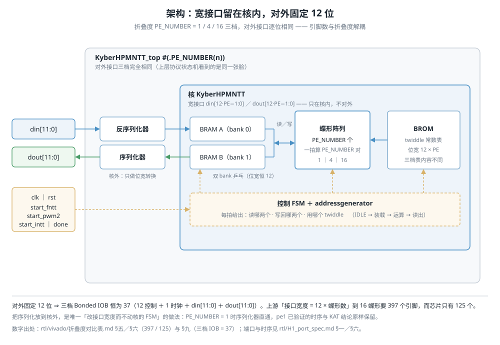

# 二、设计与创新点

> **状态**：🔄 **初稿（2026-09-30）**。本章讲**设计**（架构与取舍），数字在
> `03_performance_and_resources.md`，与公开工作的横向对比在 `01_background_and_related_work.md`。
>
> 原料：`../../rtl/folding_param_design.md`（A 的设计定稿）、`../../rtl/H1_port_spec.md`
> （端口与时序，周期数全部实测）、`../../rtl/vivado/folding_comparison.md`（三档实测数字）。
>
> 对应评分项：**创新性 30 分**。
>
> ⚠️ **本章的边界**：§2.1–§2.7 描述 **NTT 核**（含参数化与序列化）；
> §2.8–§2.9 是**系统级**的软硬件划分与接口设计（PC 上位机 ↔ PL 板级 wrapper），
> 对应《选题指南》§3.3.5.3 第 ③ 项。**板级 wrapper（UART 收发 + 协议状态机）已完成**，
> 资源与时序实测见 `03_performance_and_resources.md` §3.13、
> 功能实测见 `04_functional_correctness.md` §4.8；端到端耗时与瓶颈归因见 §3.10.3，
> 不在本章重复。

---

## 2.1 一句话

我们**没有另写一个 NTT 算法**。上游开源基线自带 NTT / INTT / 点乘，且已通过 FIPS 203 验证 ——
重写一遍只是重复劳动。我们做的是**把上游三份手工复制的设计合并成一份以 `PE_NUMBER`
为参数的 RTL**，并解决合并路上暴露出的一条硬约束：
上游把数据口宽度写成 `12 × 蝶形数`，16 蝶形要 **397 个引脚**而芯片只有 **125 个**，
`place_design` 直接失败。对策是**核内保持宽接口、序列化放到核外、对外固定 12 位** ——
三档引脚恒为 **37**，全部走完布线。

**贡献可以分三层看**（评委如果只记一句话，记这个）：

1. **工程可行性** —— 把上游「论文里能综合、这块板子上布不下」的 16 蝶形，压到 **37 个引脚**，
   让它在 125 脚器件上**第一次能真正落地**；
2. **验证完整性** —— 同一套 RTL 的三档全部走完 **综合 → 布线 → 真板 → 时序 → 功耗**，
   不是「只综合过」；
3. **可复用的设计空间** —— 904 / 232 / 69 拍、727 / 2,000 / 8,922 LUT、168 / 160 / 154 MHz 推算，
   给后续「省面积 / 省 ATP / 省延迟」的选档一个量化依据（§3.10.6）。

---

## 2.2 架构

### 2.2.1 核的内部结构（数据通路）

一个核同时能算 **FNTT / PWM2（点乘）/ INTT** 三种运算，由 `start_*` 脉冲选择：

```
                    ┌─────────────────────────────────────────┐
   din ──┬─────────>│  BRAM A  (bank 0)                        │
         │          │  BRAM B  (bank 1)      ← 双 bank 乒乓     │
         └─────────>│                                          │
                    │        ┌──────────────┐                  │
                    │        │ 蝶形阵列      │<── BROM          │
                    │        │ PE_NUMBER 个  │    twiddle 表    │
                    │        └──────────────┘                  │
                    │              ▲                            │
                    │      addressgenerator  ← 控制 FSM         │
                    └──────────────┬───────────────────────────┘
   dout <──────────────────────────┘
```

| 部件 | 作用 | 参数化后 |
|---|---|---|
| BRAM A / B | 双 bank，一个存输入一个存输出，乒乓交替 | 深度 `2^(L+1)`，数据位宽**恒为 12** |
| 蝶形阵列 | `PE_NUMBER` 个蝶形并行，一拍算 `PE_NUMBER` 对 | 个数 = `PE_NUMBER`（1 / 4 / 16） |
| BROM | twiddle 常数表 | 数据位宽 `12 × PE_NUMBER`；**表内容三档互不相同**（见 2.4.3） |
| addressgenerator | 每拍给出「读哪两个数、写回哪两个位置、用哪个 twiddle」 | 全部改成参数 `L` 的表达式 |
| 控制 FSM | IDLE → 装载 → 运算 → 读出 | **逐档保留上游结构**（见 2.4.3） |

**折叠度**（`PE_NUMBER`）就是「一次算几个蝶形」这一个旋钮：
1 个 → 省资源但慢（904 周期）；16 个 → 快但费资源（69 周期）。

### 2.2.2 对外接口：三档完全相同

```
        ┌──────────────────────────────────────────┐
        │  KyberHPMNTT_top #(.PE_NUMBER(n))         │
din ───>│  ┌────────────┐   ┌───────────────────┐   │
[11:0]  │  │ 反序列化器  │──>│  核 KyberHPMNTT    │   │
        │  └────────────┘   │  din[12n-1:0]     │   │
        │  ┌────────────┐   └───────────────────┘   │
dout<───│  │  序列化器   │<──────────────────────    │
[11:0]  │  └────────────┘                           │
        └──────────────────────────────────────────┘
```

对外只有 `clk / rst / start_* / din[11:0] / dout[11:0] / done`，
**三档一模一样**；宽接口只留在核内部。



> 三层，从上到下依次是：`KyberHPMNTT_top` 的对外端口 ／ 核外那对序列化-反序列化器 ／
> 核 `KyberHPMNTT` 的宽接口。**这张图要说明的是「边界画在哪」** ——
> 12 位的窄接口在 `top` 上，`12 × PE_NUMBER` 的宽接口只在核内，
> 中间那层序列化器是两者之间**唯一**的转换点。
> 图中**实线是数据通路、虚线是控制**（控制 FSM 驱动 BRAM / 蝶形阵列 / BROM 的读写地址）。
> 底部三个数字（引脚 37 / 397 / 125）是引用，出处见 §2.3.3 与 §2.5。

---

## 2.3 上游基线的三个问题（这就是本设计的动机）

### 2.3.1 三份手工复制、会漂移

上游把三个折叠度写成三份独立的目录树（合计 **7,638 行**）。
逐文件比对发现它们**只剩空白与注释的差别**（`butterfly` / `modadd` / `modmul` / `intmul` /
`FA` / `HA` / `div2` / `shiftreg` 逐字节相同；`modred.v` 在 pe1 里缺了 CC0 版权注释头，
`modsub.v` 在 pe16 里缺了），**没有一处是逻辑差异** —— 也就是说三份是同一个算法的手工副本，
改一处要记得改三处。

### 2.3.2 `PE_NUMBER` 参数是「假的」

三个核文件都写了 `#(parameter PE_NUMBER=1/4/16)`，但它**只用于数组维度和 generate 循环上界**，
**从来没传进 `addressgenerator`**；地址位宽在核里也是硬编码的。
**后果：把 `PE_NUMBER` 改成 8，地址生成器不会跟着变，设计直接错。**
所以「折叠度可配置」这句话在原始代码上是不成立的。

### 2.3.3 接口宽度随折叠度线性增长 → 16 蝶形放不下

| 档 | `din` + `dout` | 控制信号 | 合计 IOB | 板子可用 | 占比 |
|---|---:|---:|---:|---:|---:|
| pe1 | 24 | 13 | 37 | 125 | 29.6% |
| pe4 | 96 | 13 | 109 | 125 | 87.2% |
| pe16 | 384 | 13 | **397** | 125 | **317.6%** |

pe16 的 `place_design` 在 `Phase 1.2 IO Placement` 直接失败。
**这坐实了是封装引脚预算问题、不是逻辑问题**：同一份 netlist 换到 Artix-7
`xc7a200tffg1156-3`（500 IOB）就布完了，而 pe16 的 LUT 只占 7020 的 **15.9%**。

---

## 2.4 参数化怎么做到的

### 2.4.1 关键结论：三档的地址数学是**同一个公式**

定义折叠参数：

```
L = log2(128 / PE_NUMBER)        pe1 → 7 ｜ pe4 → 5 ｜ pe16 → 3
```

上游三份 `addressgenerator.v` 里看似各不相同的一堆常数，代进 `L` 之后**是同一个公式**：

| 写死的东西 | pe1（L=7） | pe4（L=5） | pe16（L=3） | 统一式 |
|---|---|---|---|---|
| `c_loop` 位宽 / 终值 | 7 / 127 | 5 / 31 | 3 / 7 | `L` / `2^L - 1` |
| `raddr` / `waddr` 位宽 | 8 | 6 | 4 | `L + 1` |
| 乒乓翻转位 | `[7]` | `[5]` | `[3]` | `[L]` |
| `c_tw` 初值（前 / 逆） | 127 / 254 | 95 / 190 | 39 / 78 | `T(L)` / `2·T(L)` |
| FNTT 读口恒等门限 | `S == 6` | `S > 3` | `S > 1` | `S >= L - 1` |
| FNTT 写口恒等门限 | `S == 6` | `S > 4` | `S > 2` | `S >= min(L, 6)` |
| INTT 读口前置恒等 | 无此支 | `S < 2` | `S < 4` | `S < 7 - L` |
| INTT 写口前置恒等 | 无此支 | `S < 1` | `S < 3` | `S < 6 - L` |
| INTT 读 / 写末级恒等 | `S == 6` | `S == 6` | `S == 6` | `S == 6`（**三档相同**） |
| FNTT 移位量（读，掩码） | `6-S` | `4-S` | `2-S` | `L - 1 - S` |
| INTT 移位量（读，掩码） | `S+1` | `S-1` | `S-3` | `S + L - 6` |

**决定性数值证据**：twiddle 计数器的前向初值应为

```
T(L) = Σ_{S=0}^{min(6,L-1)} (2^S − 1)  +  Σ_{S=L}^{6} (2^L − 1)  +  7
```

算得 `T(7)=127`、`T(5)=95`、`T(3)=39` —— 与三份源码里实际写的 `9'd127` / `8'd95` / `7'd39`
**分毫不差**。三者同时命中同一个非平凡公式的概率可忽略，据此判定**三份是同一算法的三个实例**，
而不是三份各自调出来的代码。

### 2.4.2 一条重要的方法论：不能「顺手统一」

统一式很漂亮，但**三处地方不能强行统一**，因为它们是上游的真实结构分歧：

**① PWM2 的地址生成。** pe1 用双读口 + `c_pwm` 调制（PE=1 时「点乘 + 折叠最后一阶」的
数据重排必须由地址生成器显式完成）；PE≥4 时被并行度免费吸收，退化成恒等扫描。
**为什么不把 pe1 也改成恒等扫描？** 那会改掉 pe1 已经验证过的数据布局，
连带 `refsim/pe1/` 的 KAT 链全要重来。收益（少一个分支）远小于代价。

**② FSM 的 stall 结构。** 三档都在「一轮扫完」那一刻决定要不要多停一拍，
但**停的条件三档各不相同**（pe1 一处都不停；pe4 在 FNTT `S == L-1` 停 1 拍；
pe16 在 FNTT `S <= L-1` 每级停 2 拍）。它**不由 `L` 唯一决定**，
所以只把现状逐档编码，保证行为逐拍不变。

**③ twiddle 表的位宽与内容。** 地址位宽三档是 **9 / 8 / 7**（实际用到的最大 `c_tw` 是 254 / 190 / 78，
需要 8 / 8 / 7 位 —— pe4、pe16 刚好够用，pe1 多留了 1 位），是上游**手工选**的。
表内容更是**三张互不相同、且不是彼此的打包或连续切片**：
把 pe4 的表按 4 值一组去 pe1 的扁平表里找连续匹配，222 条里**只命中 32 条**；
pe16 按 16 值一组，86 条里**只命中 8 条**。

> 判定依据：`rtl/ntt_core/tools/check_brom.py` 把三张表抠出来做匹配。
> 若它们是 pe1 表的打包，**每一条都该命中**。

**所以这三处只能分支保留**。本设计因此：
① 单独开一个参数 `TW_ADDR_W`（9/8/7），**不假装能从 `L` 算出来**；
② 表内容用 `generate` 按 `PE_NUMBER` 分三支，各放一份**逐字提取**的原表（脚本从上游文件生成，不手抄）。

### 2.4.3 参数传递

对外只暴露 `PE_NUMBER`，内部派生 `L` 一路传下去：

```
KyberHPMNTT_top #(.PE_NUMBER(16))
  └── KyberHPMNTT #(.PE_NUMBER(16))
        ├── addressgenerator #(.L(3), .TW_ADDR_W(7))     L = $clog2(128 / PE_NUMBER)
        ├── BRAM            #(.ADDR_W(4))
        └── BROM            #(.PE_NUMBER(16), .TW_ADDR_W(7))
                                  ↑ TW = 9/8/7，手工选，不是 L 的函数
```

---

## 2.5 创新点：固定宽度接口 + 核外序列化

这是本设计**唯一真正解决的新问题**（2.4 的参数化是工程整理，这一条是设计）。

**问题**：上游的引脚预算随折叠度线性增长（2.3.3），16 蝶形超出 3.2 倍。
**对策**：把序列化搬到**核的外面**。

```
KyberHPMNTT_top #(.PE_NUMBER(16))
  ├── 外部：din[11:0] / dout[11:0]       固定 12 位，三档完全相同
  ├── 中层：序列化 / 反序列化器
  └── 核 KyberHPMNTT                      宽接口 din[12·PE-1:0]（只在核内）
```

**选择「核外序列化」而不是「改核的 FSM」的理由**：

1. **核的 FSM 一行不用改** —— 风险最小。装载态仍是「每拍写一次 BRAM」，只是拍数回 256
2. **`PE_NUMBER = 1` 时序列化器是直通** → pe1 已验证的时序完全不受影响
3. **序列化器能单独测**（它是一段独立的、无状态的逻辑）
4. 换器件时核的宽接口仍在，不必推倒重来

**代价**：pe16 的装载 / 读出由 16 拍变回 256 拍。
但这个代价在本项目里可以忽略 —— **UART 比装载口慢 17,361 倍**（115200 bps 送一个多项式
要 88.9 ms，而核灌满只要 256 拍 = 5.12 µs）。这点差距淹没在串口里。

**结果**：三档 Bonded IOB 都是 **37**（= 12 控制 + 1 时钟 + `din[11:0]` + `dout[11:0]`），
**三档全部走完布线**；而上游 pe16 是 397、IO 阶段就失败。
「接口宽度与折叠度解耦」就是本设计的验收判据第 1 条。

---

## 2.6 验证策略：三层判据，全部可一条命令复跑

重构最大的风险是「改坏 pe1」—— 它是**唯一功能验证过的配置**。所以本设计的条款是
**「pe1 行为逐拍不变」是第一约束**，围绕它设三层判据（强到弱）。
下表的 ①②③ 是**验证强度**的次序，与 `folding_param_design.md` §一 的判据编号对应关系为
①=判据 2、②=判据 3、③=判据 1：

| 层 | 判据 | 怎么验 | 结果 |
|---|---|---|---|
| ① **周期数逐拍一致** | 三档 FNTT / PWM2 / INTT 的周期数与上游逐个相等 | iverilog 探针 `rtl/probes/` | ✅ **12/12** |
| ② **功能对拍** | 三档 × 3 运算 × 16 组黄金向量（4096 系数）比多重集 | `rtl/probes/ntt_func_tb.v` | ✅ **4096/4096** |
| ③ **综合与引脚** | 三档 IOB ≤ 125、资源数、Fmax | Vivado `run_folding_sweep.sh` | ✅ **37/37/37，三档都布完线** |

**判据 ① 是这次重构的主安全网。** 周期数对折叠度极其敏感（任何一处地址公式或 stall
写错都会改拍数），而它又几乎零成本可测。三档周期数全对，说明**折叠算法本身没被改坏**。

**阴性对照**（段 ⑩ 末尾，`../../rtl/probes/README.md` §判据 3）：把 pe4 的 PWM2
读出顺序拨成 pe1 的那套 σ，多重集必须塌到 **22/4096**（≈ 随机命中）。
不塌说明判据本身没有分辨力 —— 没有它，「4096/4096」只说明自己跟自己对上了。

> **判据 ② 早先的两处边界，现已补齐**（2026-10-05）：
> **完整乘法 FNTT→PWM2→INTT 的端到端**由真板子的 `#PMUL FULL` 覆盖（三档各 256/256，
> 见 `04_functional_correctness.md` §4.8）。
> **探针里 PWM2 那一格**原先用的是 a == b 的向量（等于测平方），2026-10-05 补成 a ≠ b
> （`ntt_func_tb.v` 第五个 build `-DOP_PWM2AB`），三档各 4096/4096、阴性对照塌到 17/4096。
> ⚠️ 准确说这是**补上了探针的那一格**，不是补了一个设计缺陷 —— 真板子那条路径
> （`#PMUL TIME` / `#PMUL FULL`）**一直都在喂两份不同的多项式**。
> 详见 `../../rtl/probes/README.md` 段 ⑩。

---

## 2.7 本章的边界（失败分析：没做什么，为什么）

| 不做 | 为什么 |
|---|---|
| **不推导新的折叠算法** | 只把上游三档的行为统一到一份参数化 RTL，行为逐拍不变 |
| **不改 pe1 的数据布局** | 包括 PWM2 的双读口结构 —— 它是已验证配置的组成部分 |
| **不做多核并行版** | 我们做的是**折叠**（一个核跑多拍），不是**并行**（多个核同时跑）；后者是另一个设计，不在计划内 |
| **不做侧信道防护** | 不在本工作范围；`ma_tcas` 是唯一给真板侧信道数据的公开工作，只作存在性引用 |

---

## 2.8 软硬件划分依据

> 对应《选题指南》§3.3.5.3 第 ③ 项「软硬件划分依据与接口设计」。
> 本节讲**为什么这样切**，§2.9 讲**切完之后接口长什么样**。
> 协议细节的权威文件是 `../../host/proto.md`（v1.0 冻结版），
> 本节只做章节体归纳，不另立一套协议。

### 2.8.1 划分结果：只有 PC 与 PL 两端

```
   PC 上位机（Python）                 FPGA 可编程逻辑（Verilog）
   ┌──────────────────┐   115200-8N1   ┌──────────────────────────────┐
   │ 向量选择 / 装载序 │ ─────────────> │ UART 位级收发 → 行组装        │
   │ 帧组装 / 异或校验 │                │ → 命令解析 → 协议状态机        │
   │ 拆帧 / 按 build 解包              │ → 系数缓冲（A/B 各 256×12）    │
   │ 数值比较 / 日志 / 存档            │ → NTT/INTT/点乘核              │
   │                  │ <───────────── │ ← 读出缓冲 → 逐行回传          │
   └──────────────────┘                └──────────────────────────────┘
```

**没有 PS、没有 AXI-Lite、没有 PYNQ Overlay，也没有完整 ML-KEM 链路** ——
这是纯 PL 实现（依据与取舍见 `01_background_and_related_work.md` §1.6）。
本作品的范围是 **NTT / INTT / 点乘核 + 串口协议状态机**，不是整套 KEM。

| 功能 | 放在哪 | 具体做什么 |
|---|---|---|
| 测试向量的选择与排列 | **PC** | 从 `refsim/batch/` 读 256 个系数，按运算与 build 摆成板子要求的装入顺序 |
| 帧组装、异或校验、超时与重试 | **PC** | 生成命令行 / 数据行；维护 §2.9.5 的握手与 §2.9.6 的错误处理 |
| 拆帧、按 build 解包、数值比较 | **PC** | 把板子回传的物理序还原成系数序，与参考实现逐点比较，写日志与存档 |
| UART 位级收发、行组装 | **PL** | 起始位/停止位采样、3 字符十六进制 ↔ 12 位系数 |
| 命令解析、协议状态机 | **PL** | 认命令、查校验、管数据段、控制核的装载/启动/读出 |
| 系数缓冲、核控制 | **PL** | 两个 256×12 的 bank；按 §2.9.7 的时序把数据连续灌进核 |

### 2.8.2 四条划分依据

**① 时序义务：核的装载口没有「数据有效」选通，只有 PL 能保证连续 256 拍。**
核的 `load_*` 一旦启动，就每个时钟沿硬写一次 BRAM，靠内部计数器数满 256 拍才退出
（`../../rtl/H1_port_spec.md` §四，探针实测）。中途停一拍、少一拍，FSM 会一直停在装载态，
后续 `start_*` 不再响应。这个义务必须由**与核同钟的硬件状态机**承担；
PC 侧无论用什么语言，都无法保证「相邻两个字节之间恰好隔 20 ns」。

**② 速度差：接口比核慢四个数量级，缓冲只能放在 PL。**
115200 bps 送一个多项式要 **88.9 ms**（4,444,444 拍 @50 MHz），
而核灌满一个多项式只要 **5.12 µs**（256 拍）—— 差 **17,361 倍**
（`../../rtl/board/poly_buf.v` 文件头）。所以「边收边灌」不是划不划算的问题，
是**物理上做不到**：必须先在 PL 里收满整组，再一次性 burst 进核。
PC 只负责按行发送，不参与这个实时过程。

**③ 可复现与可排错：文本帧、日志、比较都放在 PC。**
协议用可读的文本行（`#NTT 1*7c`、三位十六进制数据行），而不是二进制帧：
人手能在串口助手里逐字校验，出错时日志本身能说明问题，
换一组向量只改 PC 上的文件、**不必重新综合位流**。代价是文本编码比二进制多占一些字节
（12 位系数写成 3 个十六进制字符，是二进制 1.5 字节的 2 倍），
但波特率才是更大的杠杆（115200 → 921600 是 8 倍，见 `../../host/proto.md` §4.1），
这点编码开销不是瓶颈。

**④ 考察面：状态机与接口协议留在 PL 里。**
初级组的考察侧重是逻辑设计、状态机、时序约束与接口协议（`选题指南.pdf` §3.3.1.1）。
如果把协议状态机挪进 PS 软件，评委要看的那部分就被挪走了。
这不是「软件做不了」，而是**本赛道的设计取舍**：把被考察的逻辑留在被考察的位置。

### 2.8.3 为什么不用 PS / PYNQ

三条理由已在 `01_background_and_related_work.md` §1.6 逐条写过（推荐而非强制、
考察侧重、板卡不在 PYNQ 官方支持列表），这里只补一条**对本设计的影响**：

不走 PS，就没有 AXI-Lite / Overlay / DMA 这层接口，PC 与 PL 之间只剩**一条 115200 bps 的 UART**。
这直接决定了系统的端到端耗时 —— 一趟 `#NTT` 的 **99.99% 花在串口搬运**，
计算核只占 **0.0098%**（§3.10.3，`../../metrics/data/bottleneck.csv`）。
这是**有意接受**的代价：换来的是一套评委能逐层看懂、且与「纯 PL」口径一致的接口链。
如果需要更高的吞吐，正确的下一步是提高波特率或改二进制编码，而不是把协议搬进 PS ——
`../../host/proto.md` §4.1 已把这条杠杆量化（115200 → 921600 = 8×）。

### 2.8.4 为什么不能由纯软件或「转接板」替代

这一问要分开答，且**不能夸大**。

**先说结论：分档，不是一句「谁快」。** 本机实测（同一台机器、gcc -O2）软件参考 `ntt()` 约 **4.0 µs**
（`bottleneck.csv` 最近一次 4.05 µs，历次 3.36–4.05）：

| 档 | 板上频率 | 核延迟 | 对 CPU |
|---|---:|---:|---|
| pe1 | 50 MHz | 18.08 µs | CPU 快 4.5–5.4× |
| pe4 | 50 MHz | 4.64 µs | 同量级 |
| **pe16** | **50 MHz** | **1.38 µs** | **FPGA 快 2.4–2.9×** |
| **pe16** | **62.5 MHz** | **1.10 µs** | **FPGA 快 3.0–3.7×** |

所以「FPGA 一定慢」和「FPGA 一定快」都不对：**快慢由折叠度决定** —— pe16 用 12.3× 面积
换 2.4–3.7× 的实跑优势。**这个结论只用板上实跑频率**；154 MHz 推算的 0.45 µs 只作余量说明，
不写进结论（§3.10.3 同口径）。

⚠️ §1.2.2 的 `ntt()` **1.340 µs** 是另一套测量条件下的数（x86 `-O2` 的公开实测），
与这里的约 4.0 µs **不能混用**；两个数各自只在各自的口径里成立。

**纯软件实现无法提供的是本作品实际交付、且被评分的三类东西：**

1. **折叠度的资源—周期权衡**：同一份 RTL 只改 `PE_NUMBER`，周期数 **904 → 69**，
   核 LUT **727 → 8,922**（§3.3）。这是硬件结构层面的可测量性质，软件里没有对应物。
2. **一条完整的 PL 接口链**：位级 UART、行组装、七态协议机、连续 256 拍装载、
   读出缓冲与握手。它的正确性由位级验证台与真板子实测保证（§2.9.9），
   也是初级组考察面本身。
3. **时序与资源的实测证据**：50 MHz 下三档 WNS / WHS、失败端点 0、引脚落位
   （§3.13）。软件实现产生不了这些数据。

**「转接板」只改变电气连接，不提供计算。** 它能把信号从一种接口接到另一种接口，
但 NTT 仍然要由某个处理器或逻辑实现；若换成现成加速卡，那是**另一套器件与另一套实现**，
既不能在指定板卡上复现，也不满足本赛道对「在 FPGA 内完成逻辑设计」的考察要求。

**硬件优势什么时候出现？** **在 pe16 档、板上实跑频率上就已经出现**（1.38 / 1.10 µs vs 约 4.0 µs，
快 2.4–3.7×），不需要等 154 MHz。154 MHz 的 0.45 µs（快 7.5–9.0×）是**推算上限**，只说明余量；
多实例并行或把数据留在片上还会扩大，但**这些不是本报告实测过的边界**。
本报告能负责的结论只有两条：① 折叠度可配置的硬件结构已被三档实测；
② 当前端到端瓶颈在串口接口，不在核。

### 2.8.5 从这颗核到完整 ML-KEM：还缺什么（集成路线）

本作品交付的是 **NTT/INTT/点乘核 + 一条 PL 接口链**，不是完整 KEM。要把它嵌进完整的
ML-KEM-768，还缺下面几块（粗估，**未实现、不计入成果**）：

| 缺的块 | 作用 | 粗估资源（7020 共 53,200 LUT） |
|---|---|---|
| Keccak-f[1600]（SHA3-256/512、SHAKE128/256） | 哈希、PRF、KDF | ~2,000–3,000 LUT |
| CBD / 采样与拒绝采样 | 生成 a、s、e | ~1,500–3,000 LUT + 控制 |
| compress/decompress、encode/decode | 密文/公钥打包 | ~1,000–2,000 LUT |
| 系数调度与控制 | 把 NTT/INTT/PWM2 串成 K-PKE / ML-KEM | ~2,000–3,000 LUT + FSM |
| （可选）AXI/DMA 或更宽接口 | 提高吞吐 | 取决于接口选择 |

- **当前核是可替换的 NTT 阶段**：12 位系数、`start_*` 脉冲、256 拍装载/读出，接口已文档化
  （`rtl/H1_port_spec.md`），接进去不需要改核内部。
- **粗算整颗 768**：PL 逻辑约 **15k–20k LUT**（含控制），7020 放得下；BRAM 也够（当前核 34.5 tile）。
- **工作量**：2–3 人月（按三人零基础的节奏估），**不在本次提交范围**。
- **本报告不声称**「已实现完整 KEM」；这一节只回答「这颗核怎么接进去、为什么不把它算进成果」。

---

## 2.9 接口设计

> 权威规格：`../../host/proto.md`（v1.0，2026-09-29 冻结）。
> 端口与时序：`../../rtl/H1_port_spec.md`。
> 板级实现：`../../rtl/board/ntt_board_top.v`、`proto_fsm.v`、`poly_buf.v`。

### 2.9.1 物理层与引脚

| 项 | 值 |
|---|---|
| 链路 | **115200-8N1**（无校验）；波特率是参数，不是写死的常数 |
| 串口芯片 | 板载 CH340C，设备名 `USB-SERIAL CH340`；**口号运行时按设备名查，不写死** |
| 时钟 | `sys_clk` = **U18**，50 MHz |
| 复位 | `sys_rst_n` = **N16**，**低有效** |
| 数据 | `uart_rxd` = **T19**、`uart_txd` = **J15**，均 LVCMOS33，走 USB UART 那一组 |
| 时钟域 | **单时钟域**，无 CDC；UART、协议机、缓冲与核共用 `sys_clk` |

### 2.9.2 帧格式：只有三种「行」

一次事务 = **一问一答**：PC 发一条命令，板子把结果发回来，回完再发下一条。
不流水线、不排队。行与行只靠 **LF（0x0A）** 分隔，不需要帧头。

| 行的种类 | 长相 | 方向 |
|---|---|---|
| 命令行 / 应答行 | `# ... *xx` | 双向 |
| 数据行 | 恰好 3 位小写十六进制（`000`–`fff`） | 双向 |
| 空行 | 只有一个 LF | 任意，一律忽略 |

首字符是 `#` 判为命令行，是十六进制字符判为数据行。
**同步不靠帧头，靠三条自带冗余**：
① 命令参数必须回显（`#OK <原命令>`）；② 数据行条数由命令决定；
③ `#BEGIN <原命令> <count>` 的 count 必须与实际行数相等。
任何一条对不上，PC 侧立即判错位并停止整轮测试（§2.9.6）。

### 2.9.3 命令与运算的映射

| 命令 | 后续数据行 | 回传结果行 | 核的动作序列 |
|---|---:|---:|---|
| `#PING` | 0 | 0 | 无（只回 `#OK PING`） |
| `#NTT <n>` | `n×256` | 256 | `load_a_f` → `start_fntt` → `read_a` |
| `#INTT <n>` | `n×256` | 256 | `load_a_i` → `start_intt` → `read_a` |
| `#PMUL NTT <n>` | `2n×256`（前 A 后 B） | 256 | `load_a_i` + `load_b_i` → `start_pwm2` → `read_a` |
| `#PMUL TIME <n>` | `2n×256` | 256 | `load_a_f` + `load_b_i` → `start_fntt` → `start_pwm2` → `start_intt` → `read_a` |
| `#PMUL FULL <n>` | `2n×256` | 256 | `load_a_f` + `load_b_f` → `start_fntt`（A、B 各一次）→ `start_pwm2` → `start_intt` → `read_a` |
| `#ABORT` | 0 | 0 | 放弃当前事务，回「等命令行」 |

`n` 已冻结为 **1**（一次事务一组 256 个系数）。
⚠️ **`#PMUL` 虽然收 512 行，但只回 256 行**（两个多项式点乘后仍是一个多项式）；
PC 侧收多少行**听板子的 `#BEGIN` 报数**，不听自己的假设。
三种点乘的区别只在「A/B 各自在哪个域」，域词写成英文（`NTT` / `TIME` / `FULL`）
而不是单个字母，是为了让日志自己会说话。

### 2.9.4 数据编码与顺序

- 一个多项式 **256 个系数**，每个 **12 位**（`0..3328`，模数 q = 3329），
  线上写成**恰好 3 位小写十六进制 + LF**。板子端宽容接收大写与 `\r`，但 PC 端只发小写。
- **装载顺序按（运算，折叠度）分档**，没有一句话能概括。最反直觉的一格：
  `#INTT` 与 `#PMUL NTT` 都走 `load_*_i`，但 pe4/pe16 上要求不同
  （INTT 仍要交织，PWM2 变成自然序）。完整五行表在 `../../host/proto.md` §5.3.4，
  上位机按这张表摆序；**不要按装载路径外推**。
- **读出顺序**：板子按自己读出的**物理顺序原样回传**，不做地址重排。
  PC 按「刚发的是哪条命令」选择解包表：
  FNTT 读出在 pe1 是交织（`0,2,1,3,...`）、pe4/pe16 是自然序；
  INTT 是 `0,128,1,129,...`；点乘读出与 INTT 相同（三档一致）。
  ⚠️ **FNTT 的读出序随折叠度变**，而折叠度编译进位流、命令里没有这个字段 ——
  这个信息由复位后板子自发的一行 **`#RDY <ver> <build> <errs>`** 带出，
  `<build>` 就是 `PE_NUMBER`（1 / 4 / 16）。`#RDY` 是尽力而为的一行，
  丢了不影响后续事务；确认板子在线用 `#PING`。
- 板子端**不查系数值域**：只查「恰好 3 位十六进制」的格式。
  `d01`（= 3329）会被照收照算，这是当前冻结版的口径，不是遗漏
  （`../../host/proto.md` §4.3）。

### 2.9.5 握手与超时

一条计算事务的四步（以点乘为例）：

```
PC → 板   #PMUL TIME 1*03 ⏎
板 → PC   #OK PMUL TIME 1*27 ⏎        ← 板子「在听」；PC 收到它之后才发数据
PC → 板   512 行数据（A 256 + B 256）
板 → PC   #BEGIN PMUL TIME 1 256*75 ⏎ ← 算完了；PC 收到它之后才开始收结果
板 → PC   256 行结果
板 → PC   #DONE PMUL TIME 1 256*32 ⏎  ← 本事务结束
```

**`#OK` 与 `#BEGIN` 分两行是刻意的**：前者证明链路通，后者证明算得完。
两种故障因此能在日志里分开。**PC 在收到 `#OK` 之前一个数据字节都不发**；
**板子在收到完整命令行后必须立刻回 `#OK`**，否则双方互等、死锁。

所有等待都有上限（数值可配置，测试台会调小）：

| 超时 | 在哪一侧 | 起算点 | 默认 | 到时动作 |
|---|---|---|---:|---|
| `T_LINE` | 板 | 本行第一个字节 | 1 s | 丢弃本行，回 `#ERR 05`，回到「找行首」 |
| `T_CMD` | 板 | 命令行**字符间**超时 | 10 s | 丢弃半行，**静默**回「等命令行」 |
| 等命令行时 | 板 | 尚未收到第一个字节 | **不设超时** | 一直等 |
| `T_CORE` | 板 | 发出 `start_*` 之后 | 100 ms | 回 `#ERR 06` |
| `T_OK` | PC | 发出命令帧之后 | 1 s | 记日志，走重试 |
| `T_BEGIN` | PC | 数据行发完之后 | 5 s | 记日志，走重试 |
| `T_RX` | PC | 收到 `#BEGIN` 后每等一行 | 1 s | 记日志，走重试 |
| `T_DONE` | PC | 数据行收齐之后 | 1 s | 记日志，走重试 |

**为什么 `T_LINE` 取 1 s 而不是「一行 347 µs 所以取 4 ms」**：CH340 走 USB 分包，
Windows 调度有抖动；1 s 相对 347 µs 约 2900 倍余量，既能容忍抖动，又远小于人感觉卡死的时间。
**关键不是数值大小，是必须有一个有限的上限** —— 与 `../../CLAUDE.md` 约定 2
「testbench 里不要写无界等待」是同一条原则，推广到了板子端。

**重试规则**：任一时序超时 → 先发 `#ABORT`（并读掉它的 `#OK ABORT`），
再整条重发，最多 3 次；3 次仍失败则记录并继续下一条，不中止整批。
所有命令都是**覆盖式**的（没有累加、没有续传），所以重复执行结果相同，重发是安全的。

### 2.9.6 错误处理

| code | 含义 | 「位置」段填什么 |
|---|---|---|
| `01` | 未知命令 | `0` |
| `02` | 参数非法 | 出错字段的序号 |
| `03` | 校验错 | `got=<实际> exp=<应有>`（整段是一个 token） |
| `04` | 数据行格式错 | 第一个非法字符的位置 |
| `05` | 数据行数不足 / 行超时 | 已收到的行数 |
| `06` | 板内错误（核未按时 `done`） | `0` |
| `07` | 忙 | `0`（正常流程不可能出现，是状态机断言） |

三条纪律：**收到 `#ERR` 不重发**（链路是通的，重发只会得到同一个错误）；
**回显对不上立刻停整轮**（错位后后面所有字节归属不明，不做猜测性跳过）；
**不做静默恢复**（每次重试都在日志里留一行，不把链路不稳藏起来）。
最关键的一条是：板子在数据段超时后**必须回到「等命令行」**，
否则 PC 之后发的 `#` 会被当成数据、数据又被当成上一条的尾巴，全线静默错位。

### 2.9.7 板内缓冲：为什么必须是 256×12×2

核的装载口没有 valid 选通（§2.8.2 ①），而串口送一组要 88.9 ms、核灌满只要 5.12 µs，
差 **17,361 倍**。所以板级必须有一块缓冲，先收满再 burst：

- `poly_buf` = **A、B 两个 bank，各 256 × 12 位**，合计 6,144 位；
- 写口由行解析器逐行写入（`sel_b` 选 A 或 B），读口用组合读，
  装载状态机用一个计数器从 0 数到 255，一拍取一个，保证 256 拍连续不断；
- 读出时，核的回传流是连续 256 拍（第 257 拍越界，必须丢），
  而 UART 发一行要 **1736 拍**，慢约 **4000 倍**，接不住 ——
  所以先接进缓冲，再由协议机慢慢发。此时 A bank 的数据早已进核，
  正好借它当读出缓冲，**不额外占一块 RAM，也不占引脚预算**。

这块缓冲是**架构必需**，不是可选优化。它也是「板级 wrapper 占了大部分 LUT」的由来之一：
pe1 那一档 wrapper ≈ 4.3k LUT，核只占 727（§3.13.7）。

### 2.9.8 复位与时钟

- **复位极性相反**：例程与协议机用 `rst_n`（低有效），而上游核的 `reset` 是**异步高有效**。
  板级顶层只在引脚处把 `sys_rst_n` 换成 `rst_n`，给核时取反（`~rst_n`）。
  这条不写下来一定会有人接错，所以写在 `ntt_board_top.v` 文件头。
- **复位同步器**：按下时异步清零，松开后等两个时钟再放行，滤掉机械按键抖动。
  代价是两个触发器；不这么做，七态协议机可能停在没人处理的状态。
- **单时钟域**：`sys_clk` 50 MHz 同时驱动 UART、协议机、缓冲与核，没有 CDC 路径。

### 2.9.9 接口怎么验

**三层证据，强弱不同，不能互相替代：**

| 层 | 验什么 | 结果 |
|---|---|---|
| 位级协议台（真 UART 在环路里） | 帧格式、校验、超时、`#RDY`、错误码 | **273 个比对点 / 失败 0**（含 `#NTT 1` 的 256 行；`+fast` 跳过 T5 时 15 个点） |
| 上位机陪练与自测 | 命令行/数据段行为、超时与重试、解包序、链路层 | 陪练两层 **691 + 97 项**、链路层 36 项、协议表 14/14、解包 160 项；B 的 10-17 全新克隆里 **8 个 host 自测全绿** |
| 真板子 | 电气层 + 端到端事务 | **2026-10-18 三档各六条命令 6/6**（含 `#PMUL TIME 1`；PING 成功，五条计算事务各 256 个系数零差异）；提频版 80 / 75 / 62.5 MHz 同样各 6/6（`reports/board_pe*_txn.txt`）。10-15 那次 5/6 的缺口是向量变长格式，B 于 10-17 修复 |

**端到端耗时与核的耗时必须分开看**：一趟 `#NTT` 在真板子上约 **0.181 s**，
而核本身 pe1 只要 **18.08 µs**（905 拍 @50 MHz）—— 计算占比 **0.0098%**。
**接口是瓶颈，不是核**（完整归因见 §3.10.3）。这条结论对接口设计的含义是：
下一步优化应该先动波特率或编码，而不是继续加大折叠度。

---

## 2.10 数据溯源

| 内容 | 出处 |
|---|---|
| 地址数学的统一式、`T(L)` 公式与三档数值 | `../../rtl/folding_param_design.md` §三（每行回源码逐字核过，附行号） |
| 三处结构分歧（PWM2 / stall / BROM） | 同上 §3.2、§3.3；BROM 匹配实验 `../../rtl/ntt_core/tools/check_brom.py` |
| 397 / 125 引脚与 IO 阶段失败 | `../../rtl/vivado/folding_comparison.md` §五／§六；`../../rtl/H1_port_spec.md` |
| 三档 IOB = 37、三档布完线 | `../../rtl/vivado/folding_comparison.md` §九（判据 1） |
| 三档周期数 12/12 | `../../rtl/probes/README.md` §判据 2 |
| 三档功能对拍 4096/4096 与阴性对照 22/4096 | 同上 §判据 3 |
| UART 与装载口 17,361× | `../../rtl/H1_port_spec.md` §四 |
| 端口与时序（`done` = `CC+1`、读出第 3 拍等） | 同上 §一／§二／§三 |
| 物理层、帧格式、命令表、错误码、超时值 | `../../host/proto.md` §4.1／§5.1／§5.2／§5.5（v1.0 冻结版） |
| 装载序与读出序（按运算与 build 分档） | 同上 §5.3.4；探针实测 `../../rtl/H1_port_spec.md` §五 |
| 板内缓冲的必要性与 17,361× / 4000× | `../../rtl/board/poly_buf.v` 文件头（含数值与推导） |
| 复位极性与同步器、引脚换算 | `../../rtl/board/ntt_board_top.v` 文件头；`../../rtl/board/ntt_board.xdc` |
| 核延迟 18.08 µs、软件参考约 4.0 µs、串口 184.4 ms | `../../metrics/data/bottleneck.csv`；生成脚本 `../../metrics/bottleneck.py` |
| 端到端 0.181 s 与计算占比 0.0098% | `03_performance_and_resources.md` §3.13.6／§3.10.3 |
| 位级协议台 273 点、陪练与上位机自测项数 | `../../rtl/board/tb/uart_proto_tb.v`；`../../host/src/`；`../../logs/verification_2026-10-17_B_clean_clone.json` |

**复跑**：

```sh
cd rtl/probes && sh run_probes.sh      # 判据 1 + 2（含阴性对照），一条命令
cd rtl/vivado && sh run_folding_sweep.sh   # 判据 1（综合与引脚），三档
cd rtl/board/tb && sh run_uart_check.sh    # 位级协议台（默认全跑；+fast 跳过 T5）
cd metrics && python bottleneck.py          # 三段归因表（PC + python，不碰板子）
```
