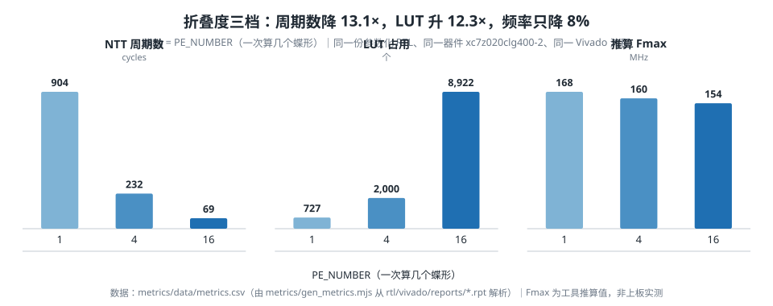
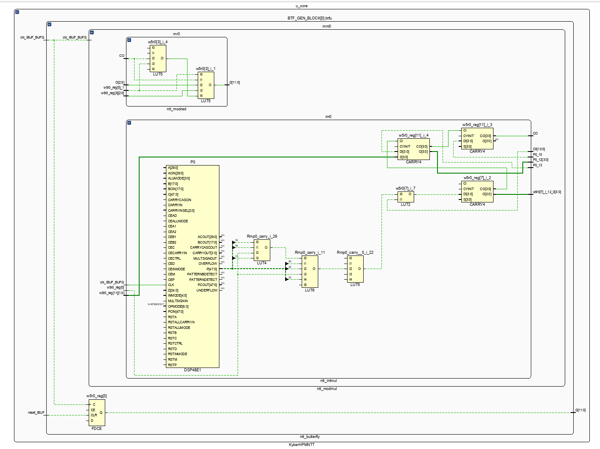
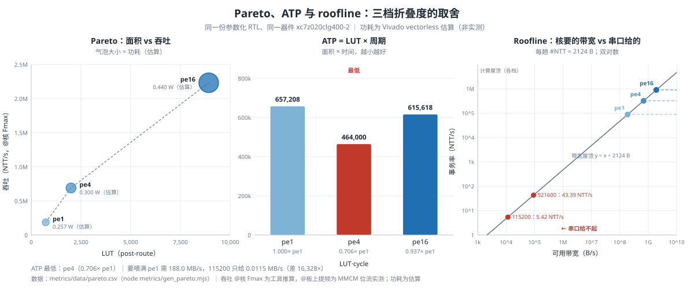
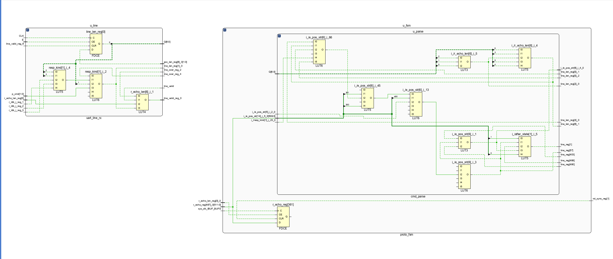

# 三、性能与资源

> **状态**：🔄 **初稿（2026-09-29；板级实测 2026-10-04 补）**。
> **3.1–3.12 是核（`KyberHPMNTT_top`）的 Vivado `post-route` 工具结果**；
> **3.13–3.16 是板级（`ntt_board_top`）上真板子之后的实测** —— 两个边界，分别看，**不要拼表**。
> ✅ **2026-10-18 状态**：端到端延迟已走正式路径（§3.13.6 / §3.10.3）；
> 上板真实最高频率已补 —— MMCM 提频 **80 / 75 / 62.5 MHz**，三档位流各 6/6（§3.10.2）。
> 原「不做」判断的改判过程保留在 §3.10.1（器件实有 4 MMCM / 4 PLL / 32 BUFG，`sys_clk` 脚 U18 是 MRCC）。
> RTL 若再有改动，本章数字要重跑 —— 报告定稿前重跑一次 `node metrics/gen_metrics.mjs`。
>
> 对应评分项：**性能与资源 20 分**。每个数都能指到 `metrics/` 或 `rtl/vivado/reports/` 里的具体文件。

---

## 3.1 一句话

折叠度做成可配置的：1 / 4 / 16 个蝶形三档，**NTT 周期数从 904 降到 69（13.1 倍）**，
代价是 LUT 占用升到 16.8%、推算频率从 168 MHz 降到 154 MHz。
**接口宽度不随折叠度变化**（三档都是 37 个引脚）—— 这是 16 蝶形那一档能放进板子、
能走完布线的前提。

---

## 3.2 测量条件（不先声明这些，数字之间没法比）

| 项 | 值 |
|---|---|
| 器件 | `xc7z020clg400-2`（**板上真实器件**），53,200 LUT / 106,400 FF / 220 DSP / 280 RAMB18 / **125 IOB** |
| 工具 | Vivado ML Standard **2020.2**，非工程模式（`synth_design` / `opt_design` / `place_design` / `route_design` 逐条跑） |
| 综合选项 | 全默认 |
| 时钟约束 | `create_clock -period 5`（200 MHz，**故意给紧**，见 3.6） |
| 测量边界 | **顶层** `KyberHPMNTT_top` —— 对外只有 `clk / rst / start / din[11:0] / dout[11:0]` 与控制信号 |
| 实现阶段 | `route_design` 完成（报告里 `Design State : Routed`，日志有 `Router Completed Successfully`） |
| 上位 | 三档都是同一份 RTL（`rtl/ntt_core/`），只改 `PE_NUMBER` 参数 |
| 报告文件 | `rtl/vivado/reports/pe{1,4,16}_nc_{util,timing}.rpt` |

> ⚠️ 另有一组「上游顶层」对照（`pe{1,4,16}_utop_*.rpt`，见 3.5）。
> 两组都取**顶层**边界 —— 顶层对顶层才谈得上比。
> 上游那三份**核**级报告（`pe*_util.rpt`，没有后缀）边界不同，不要混进同一张表。

---

## 3.3 主表：参数化版三档

| 档 | LUT | LUT% | FF | DSP | RAMB18 | BRAM tile | **IOB** | IOB% | WNS | 推算 Fmax | NTT 周期 |
|---|---:|---:|---:|---:|---:|---:|---:|---:|---:|---:|---:|
| 1 蝶形 | 727 | 1.37% | 388 | 1 | 5 | 2.5 | **37** | 29.6% | −0.936 ns | **168 MHz** | 904 |
| 4 蝶形 | 2,000 | 3.76% | 880 | 4 | 18 | 9 | **37** | 29.6% | −1.260 ns | **160 MHz** | 232 |
| 16 蝶形 | 8,922 | 16.77% | 2,933 | 16 | 65 (+2 RAMB36) | 34.5 | **37** | 29.6% | −1.507 ns | **154 MHz** | 69 |

> **频率的两条口径（引用时必须分开写）**
>
> | 口径 | 数值 | 怎么来的 | 能说什么 / 不能说什么 |
> |---|---|---|---|
> | **核的推算 Fmax** | **168 / 160 / 154 MHz** | post-route 报告 + **5 ns 故意收紧**约束反推：`Fmax = 1000 / (5 − WNS)` | 核本身的推算上限；**不是板上实测** |
> | **板级实测** | 50 MHz 基线：时钟级 WNS **+7.339 / +6.547 / +4.789 ns**；MMCM 提频版 **80 / 75 / 62.5 MHz** | 50 MHz 基线用 20 ns 约束；提频版分别按 80 / 75 / 62.5 MHz 约束并上板跑通 | 50 MHz 那组只答「余量多少」，**不能反推 Fmax**；提频那组是「按该频率烧进去、功能 6/6」，**不是芯片极限** |
>
> 三组数不同框：推算 Fmax、板级 WNS、板上跑通的频率。详见 §3.6、§3.10.2、§3.14 坑 4。

换成实际耗时（按各档自己的推算 Fmax，也是选题指导 §8.3 那条「50 MHz」条件的答案）：

| 档 | 按本档 Fmax | 按 50 MHz | 相对 1 蝶形加速比 |
|---|---:|---:|---:|
| 1 蝶形 | 5.4 µs | 18.1 µs | 1× |
| 4 蝶形 | 1.5 µs | 4.6 µs | 3.9× |
| 16 蝶形 | 0.45 µs | 1.4 µs | **13.1×** |



> **这张图说明什么**：旋钮从 1 拧到 16，换来的是**周期数降一个数量级**（904 → 69），
> 付出的是 **LUT 涨一个数量级**（727 → 8,922），而**频率只掉 8%**（168 → 154 MHz）。
> 最后这一条是本设计最反直觉、也最有利的一点 —— 详见 3.7（瓶颈在布线，不在逻辑深度）。
> 图由 `../figures/gen_figures.mjs` 从 `metrics/data/metrics.csv` 生成，数字不手抄。

---

## 3.4 这张表里的三条自证（说明数字不是跑糊了）

**① DSP 严格等于蝶形数：1 / 4 / 16。** 一个蝶形一个乘法器，一个不多一个不少。
这是最干净的一条线性项。

**② LUT / FF / RAMB18 随折叠度单调上升**（727 → 2000 → 8922 等）。
调度逻辑、数据通路、twiddle 表都随蝶形数增长 —— 增长本身是应该的，
**不增长**才说明参数没真的生效。

**③ IOB 恒为 37，这不是「三档一样所以可疑」，而是设计的不变量。**
37 = 12 个控制信号 + 1 个时钟 + `din[11:0]` + `dout[11:0]`，
**接口宽度与折叠度解耦正是本次改造的目的**（判据 1）。
所以「非退化」的举证责任由 DSP 与 LUT 两列承担 ——
一列严格 1:1、一列差 12 倍，不可能是一份网表跑了三次。

---

## 3.5 与上游同边界对照：最直观的一条是 397 → 37

| 档 | 上游顶层 LUT | 参数化 LUT | 上游 **IOB** | 参数化 **IOB** | 上游实现状态 | 参数化实现状态 |
|---|---:|---:|---:|---:|---|---|
| 1 蝶形 | 806 | **727** | 37 | **37** | 已布线 | 已布线 |
| 4 蝶形 | 2,295 | **2,000** | 109 | **37** | 已布线 | 已布线 |
| 16 蝶形 | 8,433 | 8,922 | **397** | **37** | ⚠️ **只到综合** | **已布线** |

**上游 16 蝶形放不下的原因是接口引脚数 = 12 × PE_NUMBER**：
它的 `din` / `dout` 位宽随折叠度线性变宽，16 蝶形要 384 个引脚 + 13 个控制 = 397 个，
而 7020 只有 125 个 —— 超出 3.2 倍，`place_design` 在 `Phase 1.2 IO Placement` 直接失败。
改成「核保持宽、序列化放在核外、对外固定 12 位」之后，三档都是 37 个引脚，**全部走完布线**。

**另外两处要写清，否则这张表会被读错：**

- **上游 16 蝶形那一行与参数化那一行不是同一个阶段**：上游的 LUT/FF 是综合后的值、
  WNS 是综合后估值（布局都没跑），参数化是布线后实测。LUT/FF 可大致比，**WNS 不可比**。
- **1 / 4 蝶形两档参数化版反而更小**（LUT −79 / −295，1 蝶形 WNS 也更好）：
  串行化外壳的开销小于上游顶层里与本树归并叶子时省下的量。
  但 **16 蝶形参数化版更大**（LUT +489、FF −167）—— 串行器在 16 蝶形上要攒 16 个系数，
  代价在这一档才显出来。**这是折中，不是白拿的。**

---

## 3.6 频率是反推出来的，WNS 为负是设计如此

约束故意给得比三档能达到的都紧（目标 200 MHz），所以时序**一定不收敛**，WNS 一定为负。
真实能跑多快由这条反推：

```
T_min ≈ 目标周期 − WNS          Fmax = 1000 / T_min
```

| 档 | 目标周期 | WNS | T_min | 推算 Fmax |
|---|---:|---:|---:|---:|
| 1 蝶形 | 5.000 ns | −0.936 ns | 5.936 ns | **168 MHz** |
| 4 蝶形 | 5.000 ns | −1.260 ns | 6.260 ns | **160 MHz** |
| 16 蝶形 | 5.000 ns | −1.507 ns | 6.507 ns | **154 MHz** |

**如果哪天 WNS 跑出来是正的，说明 5 ns 太松、设计没被逼到底，要收紧周期重跑。**
（`metrics/gen_metrics.mjs` 把「WNS 必须为负」写成了断言，解析出正数就直接报错退出。）

---

## 3.7 关键路径：瓶颈是**布线**，不是逻辑

三档的最差路径**都在同一个位置**：蝶形内部，模乘的 DSP 输出 → `w5r0` 寄存器。

| 档 | 源 | 终点 | 数据路径延迟 | 其中布线 | 逻辑级数 |
|---|---|---|---:|---:|---:|
| 1 蝶形 | `u_core/BTF_GEN_BLOCK[0].btfu/mm0/im0/P0`（DSP48E1） | `.../w5r0_reg[3]/D` | 5.836 ns | 4.018 ns（**68.9%**） | 9 |
| 4 蝶形 | `...[2].../mm0/im0/P0` | `...[2].../w5r0_reg[0]/D` | 6.113 ns | 4.374 ns（**71.6%**） | 9 |
| 16 蝶形 | `...[9].../mm0/im0/P0` | `...[9].../w5r0_reg[0]/D` | 6.352 ns | 4.400 ns（**69.3%**） | 10 |

两条结论：

1. **延迟里 69%～72% 是布线，逻辑只占三成。** 逻辑级数 9～10 级、逻辑延迟 1.7～2.0 ns，
   本身并不深；把频率推不上去的是**线**。所以「加折叠度」不会让逻辑变深 ——
   这也是为什么三档 Fmax 只从 168 掉到 154 MHz（掉 8%），而周期数掉了 13 倍。
2. **三档的最差路径都在蝶形内部，外壳没有更长的一条路。**
   这解释了一个看着像笔误的观察：上游 4 蝶形顶层的 WNS 与参数化版**完全相同**
   （都是 −1.260 ns）。两条日志是各自独立 grep 出来的 —— 因为瓶颈都在同一个蝶形里，
   外壳比它短，谁都不是关键路径。



**这张图是什么**：上表第一行的现场版（Vivado 2020.2 时序报告截图，A 2026-10-15 截）。
源 `u_core/BTF_GEN_BLOCK[0].btfu/mm0/im0/P0/CLK`（DSP48E1）→
`u_core/BTF_GEN_BLOCK[0].btfu/w5r0_reg[3]/D`，slack **−0.936 ns**、9 级逻辑、5.836 ns、
路径上 11 个 cell；与 `../../rtl/vivado/reports/pe1_nc_timing.rpt` 第一条
`Slack (VIOLATED)` 逐格核对过。

> ⚠️ **负 slack 是预期的，不是故障**：核的约束是**故意收紧的 5 ns**，用来从 WNS 反推最高频率；
> 报告正文 §3.3 就是这么取值的。别把它当成「时序没收敛」处理。

---

## 3.8 时钟门控：Vivado 收下了，而且仍然只有一个时钟域

参数化版用一个 ICG 把核的时钟按 1/PE 门控（`ce_lat` 用 `!clk` 采，再接 BUFG）。
（本节数字取自 **pe16** 那一档的报告 `pe16_nc_timing.rpt` —— 负载最多，门控最重。）
实测 Vivado **没有**把它做成 LUT 拼的门控时钟，而是推成了一个 **BUFG 的使能**
（LUT2 → `BUFGCTRL_X0Y0`），单个 BUFG 驱动 2,865 个负载。
时序报告的 `Clock Summary` **仍然只有 `clk` 一个时钟域**（5,516 个端点），
没有切出第二个域 —— 时序分析统一有效，`WHS = +0.077 ns`（保持通过）。

对上板的意思：**不用为这个门控时钟额外加约束，也不用手工插 BUFGCE。**

---

## 3.9 边际成本

| 每多一个蝶形 | 1 → 4 蝶形 | 4 → 16 蝶形 |
|---|---:|---:|
| LUT | +424 / 蝶形 | +577 / 蝶形 |
| FF | +164 / 蝶形 | +171 / 蝶形 |
| DSP | **+1 / 蝶形** | **+1 / 蝶形** |
| RAMB18 | +4.3 / 蝶形 | +3.9 / 蝶形 |

DSP 严格 1:1 —— 唯一一条完全线性的项。
LUT 在两段上不一样（424 vs 577），因为**串行器 / 反序列化器集中在 16 蝶形那一档**：
它要一次攒够 16 个系数才够喂一个宽拍。这是 3.5 里「16 蝶形参数化版反而更大」的同一件事。

---

## 3.10 本章的边界（没测什么，为什么）

写清楚边界比含糊地说「性能优秀」有用 —— 被追问时不被动。

> ⚠️ 本节的三条子节（3.10.1 / 3.10.2 / 3.10.3）**已不只是「没测什么」**：下面那张表里
> 有几条从「不做 / 空位」变成了「做 / 已办结」，子节就是它们的**原地更新**。
> 一条判断被推翻的过程本身是评分项「自我纠错轨迹」要的东西，所以**改了不删**。

| 没测 | 为什么 | 什么时候补 |
|---|---|---|
| **上板实测最高频率** | ✅ **2026-10-18 当天闭环** —— 三档 MMCM 提频到 **80 / 75 / 62.5 MHz**，setup/hold/pulse width 全 MET、失败端点 0（§3.10.2）；**位流当天上真板，各 6/6 PASS**（`reports/board_pe<N>_f<MHz>_txn.txt`）。⚠️ 口径：是「按这个频率烧进去、功能全对」，不是扫描仪测出的芯片极限 | 已做 |
| **提频后三档新 WNS / 新资源** | ✅ **2026-10-18 已填** —— §3.10.2 三列齐全；资源几乎不变（LUT 差 +9～+23） | 已做，`sh rtl/vivado/run_board_freq_sweep.sh` |
| ~~**PC 侧分段耗时（瓶颈归因）**~~ | ✅ **2026-10-16 办结**，**2026-10-22 口径修订** —— 见 **§3.10.3**。计算核 **18.08 µs** ／ 串口搬运 **184.4 ms** ／ 软件参考实现 **4.80 µs**（`poly_ntt()` 语义、每轮合法输入、跨会话累计中位）；结论「**瓶颈不在核，在接口**」 | 已做，`python metrics/bottleneck.py` |
| ~~**端到端延迟（正式）**~~ | ✅ **2026-10-18 已走正式路径** —— `run_board_txn_report.sh` + `host/src/board_run.py` 在真板子上跑完三档各六条命令（6/6），原始输出 `reports/board_pe{1,4,16}_txn.txt`（50 MHz）与 `..._f{80,75,62.5}_txn.txt`（提频） | 已做 |
| ~~**功耗**~~ | ✅ **2026-10-18 已做估算** —— 见 **§3.10.5**。50 MHz 三档 **0.130 / 0.170 / 0.335 W**；提频版 0.257 / 0.300 / 0.440 W。⚠️ 是 **vectorless 估算**（无 SAIF、Confidence Medium、只算片内 PL），**不是实测** | 已做，`sh rtl/vivado/run_board_power.sh` |
| **多 PE 并行版** | 我们做的是**折叠**（一个核跑多拍），不是**并行**（多个核同时跑）；后者是另一个设计 | 不在计划内，报告里写清不做 |
| **上游 16 蝶形的真实后布线数据** | 它的引脚数超出封装，布局跑不完 | 不可得（除非换封装，见交叉核对那组 Artix-7 数据） |

> ⚠️ **端到端延迟那一项，要把链路算进去。** 115200 bps 的串口传 256 个 12 位系数
> （按协议打包）本身就要一段时间，**远大于**核的 **18.1 µs**（pe1 @ 板上 50 MHz，§3.3）——
> 3.13.6 实测的 ~0.18 s 基本全是串口传输，比核延迟大 **4 个数量级**。
> 报告里要把「核的延迟」与「端到端延迟」**分开写**，别混成一个数。
>
> ⚠️ **引核延迟必须说清是哪一档、哪个频率基准** —— §3.3 表里三档各有「自身推算 Fmax」
> 与「板上 50 MHz」两个基准，一共 6 个数。上面按 **pe1（板上真烧的那一档）@ 板上 50 MHz**
> 取；若按 pe16 @ 板上 50 MHz（1.40 µs）则差 **5 个数量级**。

### 3.10.1 ★「上板实测最高频率」—— 2026-10-15 改判：从「不做」改成「做」

⚠️ **本小节原标题是「为什么不做」。原判断连同它的三条理由一并保留在下面** ——
一条判断被推翻的过程，本身就是评分项「大模型协作记录 · **自我纠错轨迹**」（《指南》
§3.3.5.3 第⑤项）要的东西。所以**改了不删**。

**原判断**（A 2026-10-07 定）：不做。三条理由 —— ① 板上没有 MMCM/PLL ② 要测它是一轮新战役
（板级关键路径在协议状态机，得收紧约束反复重跑，结果只填一格表）③ 端到端被串口卡住
4 个数量级，提频的增益测不出来。

**2026-10-15 复核结论：理由 ② 站得住，理由 ① 是错的，理由 ③ 答错了问题。**

- **理由 ① 不成立 —— 这是一个无效推论。** MMCM / PLL / BUFG 是 **FPGA 内部的时钟资源原语**，
  不是「板上的元件」。查「我们的 RTL 与 XDC 里有没有例化」，只能回答「**我们有没有用**」，
  回答不了「**芯片里有没有**」。当场用 Vivado 2020.2 `link_design -part xc7z020clg400-2` 查实：

  | 查什么 | 结果 |
  |---|---|
  | `sys_clk` 引脚 U18 的 `IS_CLK_CAPABLE` / `PIN_FUNC` | `1` ／ `IO_L12P_T1_MRCC_34` —— **是 MRCC**，可直接进 MMCM |
  | 器件时钟资源 | **MMCME2_ADV × 4** ｜ **PLLE2_ADV × 4** ｜ **BUFGCTRL × 32** |

  即：**这块芯片有 4 个 MMCM，我们一个都没用。**「板上唯一可用的频率是 50 MHz」不成立 ——
  50 MHz 是**晶振**给的，MMCM 可以把它倍频后驱动核。

- **理由 ③ 答错了问题。** 「端到端被串口主导、提频对端到端无可测增益」这句话本身是对的，
  但**它证明的是「提频对端到端没用」，不是「这个数没有意义」**。§3.3 里三档「推算 Fmax」
  本来就是**核自身**的指标，与端到端无关；同理，**提频后核能跑到多少**也是核自身的指标。
  把「端到端测不出」当成「核的 Fmax 不用测」，是**把两个口径混成了一个**。

**改判后的做法**（排进 W4，见 `team/roles_and_duties.md` §八 第 1 件）：例化 MMCM 把板上时钟
提上去 → 三档各自重综合 / 实现 / 布线取新 WNS → 五笔计算事务重跑 → 出一张「**优化前 vs
优化后**」对比表。⚠️ **要板子**。

> ⚠️ **2026-10-18 实测修正**：这条「要板子」只对**后半段**成立。**综合/实现拿 WNS 不需要板子**
> （当天板子没插，三档照样出了数据，§3.10.2）；需要板子的是「五笔事务在提频版上重跑」。

**改判后「可直接抄的话」**（原版把「**我们未使用** MMCM/PLL」与「**板上没有** MMCM/PLL」
混为一谈，已作废）：

> 板上时钟源为 50 MHz 有源晶振，直连 PL 的 `sys_clk`（引脚 U18，属 **MRCC** 时钟专用脚）。
> 本设计的**首版未例化 MMCM/PLL**，故板上工作频率即为 50 MHz；三档折叠度在 50 MHz
> （20 ns）约束下**时序全部收敛、0 条失败端点**，时钟级 WNS 分别为 pe1 **+7.339 ns**、
> pe4 **+6.547 ns**、pe16 **+4.789 ns**（取 `Intra Clock Table` 的 `sys_clk` 行，见 §3.13.3）。
> 核本身在收紧约束（5 ns）下的推算 Fmax 为 **168 / 160 / 154 MHz**（§3.3）。
> 提频测量（例化 MMCM 后三档的新 WNS 与资源）见 §3.10.2；三档提频版位流已在真板
> 跑通 `#PING` + 五条计算事务，**各 6/6 PASS**（`reports/board_pe<N>_f<MHz>_txn.txt`）。
> 端到端延迟受 115200 bps 串口主导（比核延迟大 **4 个数量级**）—— **提频对端到端无可测
> 增益**，这一点原判断是对的，不改判。

### 3.10.2 ✅ 提频前后对比表（2026-10-18 已填）

| 档 | 提频前：时钟级 WNS | 提频前：LUT / FF / BRAM / DSP | 提频后：目标频率 | 提频后：新 WNS | 提频后：新资源（LUT / FF / BRAM / DSP） |
|---|---:|---|---:|---:|---|
| pe1 | +7.339 ns | 5074 / 3496 / 2.5 / 1 | **80.0 MHz** | **+0.698 ns** | 5097 / 3503 / 2.5 / 1 |
| pe4 | +6.547 ns | 6529 / 3979 / 9 / 4 | **75.0 MHz** | **+0.754 ns** | 6543 / 3983 / 9 / 4 |
| pe16 | +4.789 ns | 12894 / 6042 / 34.5 / 16 | **62.5 MHz** | **+1.720 ns** | 12903 / 6039 / 34.5 / 16 |

> **口径**：三档都取「该档 WNS ≥ +0.5 ns 的最高可取频率」（MMCM 倍频/分频后可为 0.5 MHz 级小数，pe16 即 62.5 MHz）。MMCM 配置
> pe1 = 50×24/15、pe4 = 50×24/16、pe16 = 50×20/16（VCO 1200 / 1200 / 1000 MHz）。
> 三档 setup / hold / pulse width **全部 MET、失败端点 0**；hold 余量 +0.064 / +0.060 / +0.054 ns
> —— **都为正、但很紧**，如实写「余量小」。这是 **Vivado 全 PVT signoff**（slow/fast corner）下的 WHS，
> 不是某个温度点的抽测；**不写「余量充足」**。
>
> **资源几乎不变**：LUT 差 +9～+23、FF 差 ±7，来自时钟/复位网重映射与布局差异；
> MMCME2_ADV 与 BUFG 是专用时钟资源，**不占 LUT/FF**。
>
> ⚠️ **100 MHz 没取**：pe1 在 10 ns 下 MMCM 版 WNS **−0.066 ns**（不收敛）；
> 同一份 RTL 去掉 MMCM 只收紧约束时是 +0.343 ns —— 差的约 0.4 ns 就是 MMCM 的时钟路径。
> 100 MHz 的位流已隔离（`ntt_board_TIMING_VIOLATED.bit`），**未上板**。
>
> ✅ **上板已补（2026-10-18 15:35–15:38）**：三档提频位流各跑
> `#PING` + 五条计算事务，PING 成功、五条计算事务各 256 个系数零差异，**合计 6/6 PASS**，报告
> `reports/board_pe1_f80_txn.txt` / `board_pe4_f75_txn.txt` / `board_pe16_f62.5_txn.txt`。
> 同一天 50 MHz 基线也在当前驱动上重跑三档各 **6/6**（`reports/board_pe{1,4,16}_txn.txt`），
> 10-15 卡住的 `#PMUL TIME 1` 已随之收口。
> ⚠️ **「上板」在这里的含义**：按该频率烧进 PL、六条命令功能全对；
> **不是**用频率扫描测出的芯片极限，也不是运行中动态调频。
>
> 完整做法、关键路径与边界见 `../../rtl/vivado/board_freq_sweep.md`；
> 报告 `reports/board_pe<N>_f<MHz>_{util,timing,io}.rpt`；复跑
> `sh rtl/vivado/run_board_freq_sweep.sh`（约 30 分钟，不需要板子）。

### 3.10.3 瓶颈归因：一趟事务拆三段（2026-10-16 补）

上面那张表里「PC 侧分段耗时（瓶颈归因）」那一行已办结 —— 本节就是它的结果。
做法见 `team/roles_and_duties.md` §八 第 2 件；数字由 `python metrics/bottleneck.py` 生成
（脚本只读 `host/` 与 `research/`，不碰板子）。

一趟 `#NTT` 事务拆成三段：

| 段 | 耗时 | 在这趟里的占比 | 怎么来的 |
|---|---:|---:|---|
| ① 计算核（板上跑 NTT，pe1） | 18.08 µs | 0.0098% | 904 拍 ÷ 板上 50 MHz |
| ② **串口搬运**（115200 8N1） | **184.4 ms** | **99.990%** | 线上 2124 B × 10 bit ÷ 115200 bps |
| ③ 软件参考实现（同一件事改在 PC 上算） | 4.80 µs | —（③ 不是这一趟的一段，是 ① 的替代） | `research/kyber_ref/` 的 **`poly_ntt()` 语义**（`ntt()` + `poly_reduce()`）；每轮先拷回合法输入；本机 gcc -O2，跨 5 次会话、15 轮 × 200,000 次累计中位（2026-10-22 起，至 10-23） |

**结论：瓶颈不在核，在接口。**

三段各自的量法与边界 —— 不写清下面三条，上面的数会被引错：

- **① 是换算值，不是秒表读数。** 核嵌在协议状态机里，PC 看不见它什么时候起、什么时候停，
  板上量不出单独的核墙钟。口径是「周期数 ÷ 板上 50 MHz」（周期数出处见 §3.11）。
- **② 是模型值，但字节数是真的。** 用 B 的 `host/src/` 协议栈跑完整一趟事务（**陪练**当对端），
  数出**线上真实字节数**；波特率是协议定死的（`proto.md` §4.1）。相乘得 184.4 ms。
  ⚠️ 它**不含** USB 缓冲 / CH340 转发 / 板子换向这些电气层开销 —— 所以 **别把它当实测值引**。
  它与 §3.13.6 的实测 **0.181 s** 差 **+1.9%**，两下对得上（逐条对照见下面第三张表）。
- **③ 随机器变**（CPU / 编译器 / 优化级），上表是本机 gcc 16.2.0 `-O2` 的读数，**不是设计的属性**。
  它**不是这一趟的一段** —— 它是「同一件事不用 FPGA、改用 PC 上的软件参考实现算」的耗时，
  是 ① 的**替代**而非邻居。

#### ③ 和 ① 谁快？分档说 —— pe1 慢、pe4 相当、pe16 快

① 是核延迟（周期数 ÷ 板上频率），③ 是 CPU 单核跑 C 参考实现。三档摊开看，结论**不是一句话**：

| 档 | 板上频率 | 核延迟 ① | ① 相对 ③ | 计算阶段事务率（上限口径） |
|---|---:|---:|---|---:|
| pe1 | 50 MHz | 18.08 µs | **慢 3.8×** | 55,310 NTT/s |
| pe4 | 50 MHz | 4.64 µs | 同量级（0.97×） | 215,517 NTT/s |
| pe16 | 50 MHz | 1.38 µs | **快 3.5×** | 724,638 NTT/s |
| pe16 | 62.5 MHz | 1.10 µs | **快 4.4×** | 905,797 NTT/s |
| ③ CPU | — | **4.80 µs** | 1.00× | 208,333 NTT/s |

> ⚠️ **「计算阶段吞吐上限」只覆盖核的 904 / 232 / 69 拍计算窗口** —— 用「频率 ÷ 周期数」换算，
> 不含 256 拍装载、256 拍读出、协议控制与串口。**它不是整机可持续吞吐**，见下一条。

- **pe1 是「面积优先」档**：727 LUT 换 18 µs，比 CPU 慢 3.8 倍 —— 这是故意的取舍，不是失手。
- **pe4 与 CPU 同量级**（4.64 µs vs 4.80 µs），面积只有 2,000 LUT。
- **pe16 在板上实跑就比 CPU 快 3.5–4.4 倍**（50 / 62.5 MHz），**不需要拿 154 MHz 的推算值撑场面**。
- 154 MHz 下 pe16 的 0.45 µs（比 CPU 快约 10.7×）是**推算**，只说明「如果只约束核，还有多少余量」，不参与结论。

⚠️ **2026-10-22 口径修订：③ 量的是 `poly_ntt()` 语义，不是裸 `ntt()`。**
`poly_ntt = ntt + poly_reduce`；每轮先把合法输入（系数在 [0,q)）拷回工作数组，
再计时净计算（输入准备的 512 B memcpy 另计，约 0.01 µs）。
此前的 3.36–4.05 µs 是**裸 `ntt()`**（不约减、反复调用会让输入越界），**不能与硬件 `#NTT` 直接比**。
本轮本机读数为 **4.80 µs**（2026-10-22 与 10-23 共 5 次会话、15 轮 × 200,000 次累计中位，
范围 4.70–5.10 µs；AMD Ryzen 9 7945HX，gcc 16.2.0 `-O2`，电源模式未控制）。
⚠️ 同一台机器跨会话会漂移约 ±10%（笔记本 CPU 调频），**单次读数的第三位小数不可当精确值**；
原始轮次逐次追加在 `metrics/data/bottleneck_ref_raw.csv`，报告引用的是累计中位。
⚠️ 这是**便携 C 参考实现**，不是 AVX2 等优化软件；结论只对这条基线成立，**不暗示已击败优化实现**。
⚠️ ① 不含串口搬运，③ 不含进程启动；两者都只比「核/函数」，不是端到端。

**目标不是「所有档位都赢 CPU」。** pe1 用 727 LUT 换面积，本来就该慢；pe16 用 12.3× 面积
换 3.5–4.4× 的实跑优势 —— 这正是折叠度给出的**设计空间**：省面积选 pe1、LUT·cycle 最低选 pe4、
最低延迟选 pe16（§3.10.6）。真正的贡献不是「某一档最快」，而是**同一套 RTL 在三个点上同时成立**。

**对「瓶颈不在核」这个结论，③ 的快慢无关紧要**：无论核是 18 µs 还是 3 µs，
两者都被 **184 ms 的串口搬运**淹没 **4–5 个数量级**。这正是本节要说明的事。

#### 能算多快 ≠ 能交付多快：三层延迟（2026-10-22 补）

同一件事有**三个不能互换的边界**。对外说「吞吐」时必须带上层名：

| 层 | 定义 | pe1 @80 MHz | pe4 @75 MHz | pe16 @62.5 MHz |
|---|---|---|---:|---:|
| ① 纯计算 | 周期数 ÷ 板上频率 | 11.30 µs / 88,496 NTT/s | 3.09 µs / 323,276 NTT/s | 1.10 µs / 905,797 NTT/s |
| ② 片内装载→读出（下界） | (256 + 周期数 + 256) ÷ 板上频率 | 17.70 µs / 56,497 NTT/s | 9.92 µs / 100,806 NTT/s | 9.30 µs / 107,573 NTT/s |
| ③ 真实串口事务 | 命令 → `#DONE` 墙钟（实测，pe1） | 0.250 s / 4.0 次/s（115200）<br>0.079 s / 12.7 次/s（921600） | 同协议、同字节数，**未单独实测** | 同左 |

- **② 是模型下界，不是测量值**：假设装载与读出各 **1 系数/拍**、与计算**不重叠**、
  不计协议控制与流水开销。真实值只会更慢，所以它是**可持续吞吐的上限**、**延迟的下限**。
- **② 把深档位拉平**：pe16 的 ① 是 pe1 的 10.2×，到 ② 只剩 1.90× ——
  折叠越深，固定的 256 拍装载 + 256 拍读出越占主导。**「最深的档最快」只对纯计算成立。**
- **③ 才是用户看到的速度**：115200 下一次 `#NTT` 约 0.25 s（§3.10.4），
  比 ② 的片内上限低 **3–4 个数量级**；40 分钟浸泡的持续事务率 **230.8 次/分 ≈ 3.85 次/s**（§3.10.7，含 20 ms 间隔）。
- ⇒ 报告与视频里**不把「频率 ÷ 周期数」叫整机吞吐**；它只说明计算阶段还有多少余量。
  接口带宽的缺口按 ② 复算见 §3.10.6。

#### 折叠度改得了核，改不了接口

| 档 | 核周期数 | 核延迟 @ 板上 50 MHz | 串口搬运 | 核占端到端 |
|---|---:|---:|---:|---:|
| pe1 | 904 | 18.08 µs | 184.4 ms | 0.00981% |
| pe4 | 232 | 4.64 µs | 184.4 ms | 0.00252% |
| pe16 | 69 | 1.38 µs | 184.4 ms | 0.00075% |

折叠度把核从 904 拍压到 69 拍（13.1×），但在端到端里那一段本来就只占万分之几 ——
**折叠度的价值要用周期数论证（§3.3），不能用端到端耗时论证。** 这一条与 §3.13.6 的结论一致。

#### 逐条命令：模型 vs 实测（复核）

| 命令 | 数据行 | 发 / 收字节 | 合计 | 模型耗时 @ 115200 | 上板实测（§3.13.6） | 差 |
|---|---:|---:|---:|---:|---:|---:|
| `#NTT 1` | 256 | 1034 / 1090 | 2124 B | 184.4 ms | 0.181 s | +1.9% |
| `#INTT 1` | 256 | 1035 / 1093 | 2128 B | 184.7 ms | 0.180 s | +2.6% |
| `#PMUL NTT 1` | 512 | 2063 / 1105 | 3168 B | 275.0 ms | 0.270 s | +1.9% |
| `#PMUL TIME 1` | 512 | 2064 / 1108 | 3172 B | 275.3 ms | ✅ 256 系数零差异（10-18） | — |
| `#PMUL FULL 1` | 512 | 2064 / 1108 | 3172 B | 275.3 ms | ✅ 256 系数零差异（10-18） | — |

> ⚠️ `#PMUL TIME` 与 `#PMUL FULL` 原先在陪练上跑不了：`halfmul_b.txt`（308 行）与
> `fullmul_exp.txt`（291 行）是**变长**行（不是 3 位十六进制），属于 `host/KNOWN_ISSUES.md`
> **B2** 那一族（24 个冻结向量文件）。**与串口、与核都无关**。
> ✅ **2026-10-18：B 的补零修复（10-17）生效，两条命令在真板上都过了** —— 三档 × 六条命令
> 各 **6/6**（`reports/board_pe{1,4,16}_txn.txt`）。⚠️ 新报告只留逐项对拍、**没有记墙钟秒数**，
> 所以「上板实测」列写「✅ 256 系数零差异」而不是一个时间；模型那两列按协议字节数算出，供复核参考。

> ⚠️ **模型的用法**：它是「字节数 × 10 bit ÷ 波特率」，**不含**电气层开销，也不含实测那个
> 读数的计时边界。两条在 **±3%** 内对得上，足以支撑「这趟耗时几乎全是串口搬运」这个判断，
> 但**别把模型值当实测值引**。

#### 这一段怎么重跑

```bash
python metrics/bottleneck.py      # 要 python + gcc；不碰板子（串口那段走陪练）
```

⚠️ 重跑会更新 `metrics/README.md` 的生成块与 `metrics/data/bottleneck.csv`；
本节表格是那一次运行的**手抄**，数字以脚本为准（照 §3.11 的规矩）。

### 3.10.4 串口提速 8×：接口瓶颈的下一层（2026-10-18 补）

上一节把瓶颈定位到「接口」。本节把接口**再拆一层**：串口线本身，与 USB 转串口的转发。

| 命令 | 线上字节 | 115200 线上 | 921600 线上 | 线上倍数 | 事务墙钟 115200 | 事务墙钟 921600 | 墙钟倍数 |
|---|---:|---:|---:|---:|---:|---:|---:|
| `#NTT 1` | 2124 B | 184.4 ms | **23.1 ms** | **8.0×** | 0.250 s | **0.079 s** | **3.2×** |
| `#PMUL NTT 1` | 3168 B | 275.0 ms | **34.4 ms** | **8.0×** | 0.328 s | **0.094 s** | **3.5×** |
| `#PMUL TIME 1` | 3172 B | 275.3 ms | **34.4 ms** | **8.0×** | 0.328 s | **0.094 s** | **3.5×** |

- **0 误码**：六条命令在 921600 下 6/6，`--check` 逐条 0/256 不同；50 MHz 与 80 MHz
  （提频版）两版位流都跑过（`reports/board_pe1_b921600_txn.txt`、`..._f80_b921600_txn.txt`）。
- **线上 8× 是确定的**：字节数 × 10 bit ÷ 波特率，换波特率就是比例关系。
- **墙钟只有 3.2–3.5×**，差的约 55 ms 不在 FPGA、也不在线上：板载 **CH340C 的 USB
  latency timer**。实测 `#PING` 往返在 **115200 与 921600 下都是 0.031 s** ——
  与波特率无关，就是两段约 15.5 ms 的 USB 转发延迟。一趟事务有 3 个这样的往返
  （命令→`#OK`、数据→`#BEGIN`、收完→`#DONE`）。
- ⇒ **接口瓶颈已经从「波特率」推到「USB 转串口定时器」上**。再往 1 Mbps 提，
  线上只从 23 ms 降到 21 ms，墙钟几乎不动 —— 所以 921600 是这一层的合理终点。

> ⚠️ **引用口径**：8× 指**线上搬运时间**，3.2× 指**事务墙钟**。正文与摘要里别把 8× 写成
> 「端到端快了 8 倍」。完整做法、分频误差与边界见 `../../rtl/vivado/high_baud_demo.md`。
>
> ⚠️ **没有做的**：长时间连续跑（只覆盖 6 条 × 2 个位流）；改驱动 latency timer
> （机器相关、不可复现，只作为「还能再快多少」的说明）。

### 3.10.5 功耗估算：折叠度与提频各自付了什么（2026-10-18 补）

Vivado `report_power` 在**布线后**的 checkpoint 上跑（六版位流：50 MHz 三档 + 提频三档）：

| 档 | 频率 | 总功耗 | 动态 | 静态 | 结温 | 其中 MMCM |
|---|---:|---:|---:|---:|---:|---:|
| pe1 | 50 MHz | **0.130 W** | 0.023 W | 0.106 W | 26.5 °C | — |
| pe4 | 50 MHz | **0.170 W** | 0.062 W | 0.107 W | 27.0 °C | — |
| pe16 | 50 MHz | **0.335 W** | 0.223 W | 0.112 W | 28.9 °C | — |
| pe1 | 80 MHz | **0.257 W** | 0.148 W | 0.108 W | 28.0 °C | **0.116 W** |
| pe4 | 75 MHz | **0.300 W** | 0.191 W | 0.109 W | 28.5 °C | **0.116 W** |
| pe16 | 62.5 MHz | **0.440 W** | 0.326 W | 0.114 W | 30.1 °C | **0.105 W** |

- **静态占大头**：0.106–0.114 W，与设计几乎无关；pe1 真正「逻辑在动」的只有 0.023 W。
- **折叠度的代价**：pe1 → pe4 → pe16，动态 **0.023 → 0.062 → 0.223 W**（约 9.7×），
  对应 LUT 727 → 8,922 等价面积。周期数 13× 的收益不是白来的。
- **提频的代价几乎全在 MMCM**：pe1 从 0.130 涨到 0.257 W（+0.127 W），其中 **MMCM 占 0.116 W**，
  逻辑只多约 0.01 W。

**能量口径：每算一次 NTT 花多少电**（= 功耗 × 延迟；延迟见 §3.10.3）：

| 档 | 频率 | 总能量 / NTT | 其中动态 | 说明 |
|---|---:|---:|---:|---|
| pe1 | 50 MHz | **2.35 µJ** | 0.42 µJ | 静态占大头（18 µs × 0.13 W） |
| pe4 | 50 MHz | **0.79 µJ** | 0.29 µJ | |
| pe16 | 50 MHz | **0.46 µJ** | 0.31 µJ | |
| pe1 | 80 MHz | 2.90 µJ | 1.67 µJ | MMCM 的 0.116 W 计入动态 |
| pe4 | 75 MHz | 0.93 µJ | 0.59 µJ | |
| pe16 | 62.5 MHz | 0.49 µJ | 0.36 µJ | |

算法很直白：`总能量 = 总功耗 × 延迟`，`动态能量 = 动态功耗 × 延迟`，延迟 = 周期数 ÷ 频率（904/232/69）。

- **50 MHz 三档的动态能量同一量级**（0.29–0.42 µJ，pe4 最低）：折叠度把同样的活分给更多蝶形，能量没有明显变差。
- **总能量 pe1 最贵**（2.35 µJ），因为静态功耗要摊在 18 µs 上；批量跑时静态可摊薄，动态才是边际成本。

> ⚠️ **2026-10-22 口径修订：不与 CPU 下能效结论。**
>
> 上表是 **FPGA 侧、纯计算窗口**的估算：`E = 功耗(估算) × 周期数 ÷ 频率`，
> 不含装载、读出、串口等待；功耗是 **vectorless**（无 SAIF、活动率未标定）。
> 若把它和 CPU 并排，两边边界并不一致：
>
> | 比法 | CPU 侧 | FPGA 侧 | 能说什么 |
> |---|---|---|---|
> | 纯计算窗口 | 45 W TDP 假设 × 4.80 µs ≈ **216 µJ**（15 W 时约 72 µJ） | pe16 动态 **0.31–0.36 µJ** | **不能**：TDP 假设 ≠ 实测功耗，vectorless 动态 ≠ 活动率标定值 |
> | 一次真实事务 | 同任务调用一次 ≈ 216 µJ（仍为假设） | 0.130 W × 0.250 s ≈ **32.5 mJ**（pe1 @50 MHz，粗算，含串口等待） | **方向相反**：端到端窗口里 FPGA 反而更贵，且两边功耗口径仍不一致 |
>
> ⇒ **本轮不主张「FPGA 比 CPU 省电」，也不把 216 µJ 当精确值引。**
> 这六版功耗估算的可信用途是**档位与提频之间的相对趋势**（静态占大头、MMCM 占提频增量），
> 不是跨器件的能效倍数。真要比能效，需要同任务、同边界、同时间窗口的实测（本轮未做）。

> ⚠️ **这是 vectorless 估算，不是实测**：没有 SAIF/VCD（`Simulation Activity File: ---`），
> 报告自评 Confidence **Medium**，绝对值可能偏 ±20%–30%；只算片内 PL，不含 CH340 / LDO；
> 25 °C、典型工艺角。**只能用量级与相对趋势，别当毫瓦级结论引。**
> 完整口径与复跑见 `../../rtl/vivado/power_estimate.md`。

### 3.10.6 Pareto / LUT·cycle / roofline：三档的取舍与接口天花板（2026-10-19 补，2026-10-22 口径修订）



图左：**Pareto**（横轴 LUT、纵轴**装载→读出上限**，气泡大小 = 功耗估算），三档互不支配；
图中：**LUT·cycle = LUT × 周期**（**面积 × 周期，不是面积 × 时间**），越低越好；
图右：**roofline**（双对数），斜线是串口带宽屋顶，虚线是各档的**片内装载→读出上限** ——
链路点（红）与核点（蓝）之间仍差着约 3–4 个数量级。

**表 A · 面积–时间指标**（资源取 §3.3 主表；只对这三个已测配置成立）：

| 档 | 周期 | LUT | FF | DSP | BRAM tile | **LUT·cycle** | 归一 | **LUT·µs @板上提频** | 归一 |
|---|---:|---:|---:|---:|---:|---:|---:|---:|---:|
| pe1（1 蝶形） | 904 | 727 | 388 | 1 | 2.5 | **657,208** | 1.000× | 8,215 | 1.000× |
| pe4（4 蝶形） | 232 | 2,000 | 880 | 4 | 9 | **464,000** | **0.706×** | 6,187 | **0.753×** |
| pe16（16 蝶形） | 69 | 8,922 | 2,933 | 16 | 34.5 | **615,618** | 0.937× | 9,850 | 1.199× |

**表 B · 两种吞吐边界与接口缺口**（功耗为估算；带宽按**文本协议**每趟 2124 B 复算，
不是「256 个系数 × 2 字节」的二进制理想值）：

| 档 | ① 纯计算上限 @板上提频 | ② 装载→读出上限 @板上提频 | ② 所需带宽 | ② / 115200 | ② / 921600 | 功耗（估算） |
|---|---:|---:|---:|---:|---:|---:|
| pe1 | 88,496 NTT/s | 56,497 NTT/s | 120.0 MB/s | 10,417× | 1,302× | 0.130 / 0.257 W |
| pe4 | 323,276 NTT/s | 100,806 NTT/s | 214.1 MB/s | 18,586× | 2,323× | 0.170 / 0.300 W |
| pe16 | 905,797 NTT/s | 107,573 NTT/s | 228.5 MB/s | 19,834× | 2,479× | 0.335 / 0.440 W |

**定义（报告、图、CSV 共用；外引时必须带层名）**：

```
LUT·cycle  = LUT × NTT 周期数                    （面积 × 周期，与频率无关；只计 LUT）
LUT·µs     = LUT × (周期数 ÷ 该档板上频率)        （面积 × 计算时间；按各档实际频率复算）
① 纯计算上限 = 频率 ÷ NTT 周期数                  （只覆盖计算窗口）
② 装载到读出上限 = 频率 ÷ (256 + 周期数 + 256)     （1 系数/拍、不重叠、无控制开销的下界）
带宽需求    = 事务率 × 每趟事务字节数（#NTT = 2124 B）
链路事务率  = 波特率 ÷ 10 bit/字节 ÷ 2124 B
```

**四条结论**：

1. **`LUT·cycle` 与 `LUT·µs` 都指向 pe4，但排名必须按各自定义分开说。**
   `LUT·cycle` 与时钟无关（0.706× pe1）；`LUT·µs` 按各档实际工作频率复算（0.753× pe1）——
   两者恰好同向，但不是同一个量，**不能把一个的倍数搬到另一个上**。
   pe16 用 12.3× 的 LUT 换 13.1× 的周期下降，`LUT·cycle` 回到 0.937×、`LUT·µs` 回到 1.199×。
   选档看约束：**省面积选 pe1、LUT·cycle / LUT·µs 最低选 pe4、最低延迟选 pe16**。
2. **「pe4 最优」的适用范围只有三个已测配置，且只计 LUT（`LUT·cycle` 与 `LUT·µs` 两个派生指标）。**
   表 A 同时列出 FF / DSP / BRAM：三档的 DSP 是 1 / 4 / 16，BRAM tile 是 2.5 / 9 / 34.5，
   它们**没有进 ATP**。若把 DSP 或 BRAM 也折算进来，排名不保证不变；本轮不下这个结论。
3. **三档在 Pareto 前沿上（按 ② 口径）。** LUT 越高、装载→读出上限越高，互不支配，
   所以「三档都保留」在面积–吞吐平面里成立，不是只留一档。
   注意 ② 把深档位拉平：pe16 的 ① 是 pe1 的 10.2×，② 只剩 1.90×（§3.10.3）。
4. **roofline 按 ② 复算接口缺口。** 三档要维持装载→读出上限，分别需要
   **120.0 / 214.1 / 228.5 MB/s**；115200 只给 **0.0115 MB/s**、921600 只给
   **0.0922 MB/s** —— 差 **10,417–19,834×**（115200，约 4 个数量级）或
   **1,302–2,479×**（921600，约 3 个数量级）。这与 §3.10.3「瓶颈不在核，在接口」是同一结论。
   ⚠️ 若改用 ① 的纯计算上限，数字是 188.0 / 686.6 / 1,923.9 MB/s、缺口更大 ——
   那是**上界口径**，不代表能交付的吞吐。

> ⚠️ **两套频率不能混**：本表吞吐按**板上提频**（MMCM 位流真跑通的 80 / 75 / 62.5 MHz，各 6/6）；
> `@核 Fmax` 是 post-route 推算（5 ns 收紧约束反推），只在 §3.3 与 CSV 的 `@核 Fmax` 行出现，
> **不能当作板上实测频率**。
> **功耗列是 vectorless 估算**（Confidence Medium、25 °C、只算片内 PL），不是实测。
> 表与图都由 `metrics/data/pareto.csv` 生成，不手抄。

**重跑**：

```bash
node metrics/gen_pareto.mjs          # → metrics/data/pareto.csv + metrics/README.md 的 GEN 块
node report/figures/gen_figures.mjs  # → 本图 + folding_sweep.svg
```

### 3.10.7 长时间稳定性：40 分钟 / 9,233 次连续事务（2026-10-21 补）

2026-10-21 22:18–22:58，pe16 位流（板上 50 MHz）、COM9、115200，连续跑 `#NTT 1`，
每次 256 个系数逐项对拍：

| 项 | 结果 |
|---|---|
| 连续事务 | **9,233 次** |
| 通过 | **9,233 / 9,233** |
| 超时 / 数值不符 / 异常 | **0 / 0 / 0** |
| 单次延迟 | avg **0.239 s**，p95 **0.250 s**，max **0.266 s** |
| 吞吐 | **230.8 次/分** |
| 事务间隔 | 20 ms（host 侧设置，非硬件极限） |

**一个必须写下来的坑**：不加 `flush` 等待、或事务间隔太小时，CH340 的 `write/flush` 会在
**~100–600 次之间永久阻塞**（host 进程不再前进，板子仍活着 —— kill 后 `#PING` 正常）。
这不是 RTL 的问题，是 USB/驱动层：`pyserial` 的 `flush()` **没有超时**。本节的跑法用
`rtl/vivado/soak_board.py`：**只 write 不等 flush**（后续每步有 1–5 s 等待，足够覆盖
1 KB 在 115200 下的 87 ms）+ 写超时 + 60 s 看门狗。**建议 host 侧把「事务间隔 / 写超时」
做成正式选项**，而不是只存在于浸泡脚本里。

> ⚠️ 边界：单板、单机、115200、pe16、文本协议；**不是误码率测试**，也不是工业温度/长时间老化。
> 20 ms 是 host 侧的等待设置，不代表硬件极限；40 分钟也不等于「永不挂」。

---

## 3.11 数据溯源

| 数 | 出处 |
|---|---|
| LUT / FF / DSP / RAMB18 / BRAM tile / IOB | `rtl/vivado/reports/pe{1,4,16}_nc_util.rpt` |
| WNS / WHS / 时钟周期 / 关键路径 | `rtl/vivado/reports/pe{1,4,16}_nc_timing.rpt` |
| 上游对照（3.5） | `rtl/vivado/reports/pe{1,4,16}_utop_{util,timing}.rpt` |
| NTT 周期数 904 / 232 / 69 | `rtl/probes/README.md` §判据 2（顶层实测 `done` − `start` − 3） |
| 三档 × 三运算的功能正确性 | `rtl/probes/README.md` §判据 3 |
| 汇总（机器生成，49 行） | `metrics/data/metrics.csv` |
| 瓶颈归因三段（§3.10.3） | `metrics/data/bottleneck.csv`（`python metrics/bottleneck.py` 生成） |
| 功耗（估算，§3.10.5） | `rtl/vivado/reports/power_pe{1,4,16}_{50,80,75,62}mhz.rpt`（`report_power`，vectorless，**非实测**） |
| Pareto / LUT·cycle / roofline（§3.10.6） | `metrics/data/pareto.csv` 与 `metrics/README.md` 的 GEN 块（`node metrics/gen_pareto.mjs` 生成） |
| 40 分钟浸泡（§3.10.7） | `logs/verification_2026-10-21_A_soak.txt`（`rtl/vivado/soak_board.py` 生成，no-flush + 看门狗） |

**本章所有表格都可以重新生成**：

```bash
node metrics/gen_metrics.mjs         # 资源/频率/周期：从报告解析 → 更新 metrics/README.md + metrics/data/metrics.csv
python metrics/bottleneck.py         # 瓶颈归因（§3.10.3）：走 host/ 协议栈 + 计时 C 参考实现
node metrics/gen_pareto.mjs          # Pareto / LUT·cycle / roofline（§3.10.6）→ metrics/data/pareto.csv
node report/figures/gen_figures.mjs  # 两张数据图：folding_sweep.svg + pareto_atp_roofline.svg
```

---

## 3.12 原 W5 待补项（2026-10-18 核：均已办结）

1. ✅ **上板真实最高频率** —— MMCM 提频 **80 / 75 / 62.5 MHz**，三档位流上真板各 **6/6**，
   新 WNS **+0.698 / +0.754 / +1.720 ns**（§3.10.2）。原「不做」判断的改判过程见 3.10.1。
   ⚠️ **「板级 WNS 不能反推 Fmax」这条仍然成立**（3.14 坑 4），别因为改判把它一起丢了。
2. ✅ **端到端延迟的正式测量** —— `rtl/vivado/run_board_txn_report.sh` + `host/src/board_run.py`
   已走正式路径：三档各六条命令 **6/6**（50 MHz 与提频版，10-18）。新报告只留逐项对拍、
   **不记墙钟秒数**；0.18–0.27 s 是 10-04 临时脚本的历史值（见 3.13.6）。
   ⚠️ 该耗时**以串口传输为主（计算占比 < 0.1%）**，不代表核的运算吞吐；
   **三段拆分见 §3.10.3**（✅ 2026-10-16 已做）。
3. ✅ **关键路径截图** —— 3.7（核）与 3.13.4（板级）两组均已嵌入正文（10-18）。

---

## 3.13 板级：上真板子之后的实测（2026-10-04 上板；数字为 2026-10-07 重建版）

```bash
PE=4 sh rtl/vivado/run_board_synth.sh     # 综合 → 实现 → 布线 → bitstream（约 10 分钟一档）
sh rtl/vivado/run_board_prog.sh           # 烧录 + 串口事务
```

⚠️ **本节 §3.13.2 / §3.13.3 / §3.13.4 / §3.13.7 的数字是 2026-10-07 那一版位流**
（`rtl/vivado/reports/board_pe*_{util,timing}.rpt` 的**现行内容**）。
10-07 给 `rtl/board/proto_fsm.v` 加了 `#RDY` 上电自发帧（协议 §5.2），**RTL 变了 ⇒ 三档位流全部重出**
（pe1 19:45 / pe4 19:33 / pe16 20:00），资源与时序**两样都跟着动**。
**这是新版才对，不是回归** —— 换 RTL 就得重出。
§3.13.6 那张端到端事务表仍是 **10-04 当天**跑的（那批只要求 RTL 功能不变）。

### 3.13.1 边界：这一节与 3.1–3.12 **不是同一层，不能拼成一张表**

| | 3.1–3.9 量的是 | 3.13 量的是 |
|---|---|---|
| 顶层 | `KyberHPMNTT_top`（核 + 12 位序列化外壳） | `ntt_board_top`（**wrapper**：UART 收发 + 协议状态机 + 行组装 + 系数缓冲 + 核） |
| 时钟约束 | `create_clock -period 5`（200 MHz，**故意收紧**） | `create_clock -period 20`（50 MHz，**板上晶振实际值**） |
| 能得出什么 | **推算**最高频率（WNS 反推） | 50 MHz 下的**时序余量** |
| 证据文件 | `pe{1,4,16}_nc_{util,timing}.rpt` | `board_pe{1,4,16}_{util,timing,io}.rpt` |

**一句话**：三档都综合 → 实现 → 布线走完，时序**全部 MET、失败端点 0**，引脚全部落位；
pe1 那一档 **86% 的 LUT 花在外围**（wrapper ≈ 4.3k LUT，核只占 727，见 3.13.7）。

### 3.13.2 资源

| 档 | LUT | 占比 | FF | 占比 | BRAM tile | 占比 | DSP | 占比 | IOB |
|---|---:|---:|---:|---:|---:|---:|---:|---:|---:|
| pe1 | 5,074 | 9.54% | 3,496 | 3.29% | 2.5 | 1.79% | 1 | 0.45% | 4 |
| pe4 | 6,529 | 12.27% | 3,979 | 3.74% | 9.0 | 6.43% | 4 | 1.82% | 4 |
| pe16 | 12,894 | 24.24% | 6,042 | 5.68% | 34.5 | 24.64% | 16 | 7.27% | 4 |

（分母：LUT 53,200 / FF 106,400 / BRAM 140 / DSP 220 / IOB 125。
IOB 恒为 **4** —— 时钟 + 复位 + 串口两线，与折叠度无关；这是 3.4③ 那条不变量的板级版本。）

### 3.13.3 时序（20 ns = 50 MHz 目标）

| 档 | WNS | WHS | 失败端点 | `sys_clk` 端点 |
|---|---:|---:|---:|---:|
| pe1 | **+7.339 ns** | +0.020 ns | 0 | 7,807 |
| pe4 | **+6.547 ns** | +0.016 ns | 0 | 8,814 |
| pe16 | **+4.789 ns** | +0.062 ns | 0 | 12,684 |

⚠️ **这三个 WNS 不能反推 Fmax** —— 见 3.14 坑 4。报告里「时钟频率」那一格取 **3.3 的推算 Fmax**
（168 / 160 / 154 MHz），这一格只答「50 MHz 下余量多少」。板上真实跑通的频率另见
§3.10.2：MMCM 提频 **80 / 75 / 62.5 MHz**，三档位流各 6/6。

⚠️ **表里的 WNS/WHS 取自 `Intra Clock Table` 的 `sys_clk` 行，不是 `Design Timing Summary`。**
后者从 2026-10-07 起给的是**全设计最坏**：加 `#RDY` 重建后，pe1/pe4 的最坏那条落在
`**async_default**` 组（复位同步器的 recovery）—— pe1 那一格是 **2.490**、时钟组却是 **7.339**
（pe4：1.879 / 6.547；pe16：4.789 / 4.789，**恰好相等**）。**同一个字段、含义变了、且不报错。**
⇒ 凡引「板级 WNS」，一律引 `Intra Clock Table` 的 `sys_clk` 行，或 `rtl/vivado/critical_paths.md` §二。
⚠️ 别把 2.490 / 1.879 读成「时序变差了」—— recovery 量的是「异步复位释放沿离时钟沿够不够远」，
**不 gate 时钟**，slack 小 ≠ 50 MHz 跑不动。也**别拿 pe16 去验这条**（它恰好相等，看不出问题）。

### 3.13.4 关键路径：三档**都不在蝶形**

| 档 | 起点 | 终点 | Slack |
|---|---|---|---:|
| pe1 | `u_line/line_len_reg[0]/C` | `u_fsm/r_echo_reg[361]/CE` | 7.339 ns |
| pe4 | `u_line/line_len_reg[2]/C` | `u_fsm/tx_len_reg[0]_rep__1/CE` | 6.547 ns |
| pe16 | `u_line/line_len_reg[6]/C` | `u_fsm/r_echo_reg[256]/CE` | 4.789 ns |

`u_line` = 行组装（十六进制字符 ↔ 12 位系数）；`u_fsm` = 协议状态机；
`r_echo` 是回显缓冲（几百位宽的寄存器，`CE` 是它的使能译码）。

→ **在 50 MHz 下，瓶颈不在 NTT 数据通路，而在串口侧的行组装与宽寄存器的使能译码。**
换句话：核还有很大的时钟余量，**先被顶到的是外围** —— 与 3.7 那条（核的瓶颈是布线、不是逻辑）
是**两条互不相干的结论**，不要混为一谈。

**这条路径的延迟构成**（数字来自 `../../rtl/vivado/critical_paths.md`，
由 `gen_critical_paths.py` 从三份 `.rpt` **机械抽取**、不是手抄）：

| 档 | 数据路径延迟 | 其中逻辑 | 其中布线 | 逻辑级数 |
|---|---:|---|---:|---:|
| pe1 | 12.488 ns | 2.074 ns（16.6%） | **10.414 ns（83.4%）** | 11 |
| pe4 | 13.188 ns | 2.895 ns（22.0%） | **10.293 ns（78.0%）** | 15 |
| pe16 | 14.716 ns | 2.184 ns（14.8%） | **12.532 ns（85.2%）** | 12 |

根因是**扇出**：起点 `u_line/line_len_reg[0]/Q` 一条网线扇出 **44**；
单跳最贵的是 `u_fsm/r_echo_len_reg[0]_0[0]`，扇出 **495**、**一跳 1.503 ns** ——
比任何一个 LUT 都慢一个数量级（平摊下来：一个 LUT **0.154 ns**、一跳走线 **0.868 ns**，**5.6 倍**）。
「板级瓶颈是布线」在板级的具体形态就是它。



**这张图是什么**：上表 pe1 那一行的现场版（Vivado 2020.2 时序报告截图，A 2026-10-15 截）。
源 `u_line/line_len_reg[0]/C` → `u_fsm/r_echo_reg[361]/CE`，slack **+7.339 ns**、
11 级逻辑、12.488 ns、路径上 13 个 cell；与
`../../rtl/vivado/reports/board_pe1_timing.rpt` 第一条 `Slack (MET)` 逐格核对过。

### 3.13.5 引脚落位

四个引脚**全部 `FIXED`**，电平均 LVCMOS33：

| 信号 | 引脚 | 说明 |
|---|---|---|
| `sys_clk` | **U18** | 50 MHz |
| `sys_rst_n` | **N16** | **低有效**（上游 `reset` 是异步**高**有效，RTL 里取了反） |
| `uart_rxd` | **T19** | USB UART 那组 |
| `uart_txd` | **J15** | 同上 |

⚠️ 全板 XDC 里 `uart_rxd`/`uart_txd` 定义了**三次**（USB UART / RS232 / RS485，三组互斥备选），
我们只用 **USB UART 那组**（T19/J15）。明细 `board_pe{1,4,16}_io.rpt`。

### 3.13.6 上板端到端：五条计算事务各 256/256

三档各跑五条计算事务（`#NTT` / `#INTT` / `#PMUL NTT` / `#PMUL TIME` 半乘 / `#PMUL FULL` 全乘），
**五条计算事务各 256/256 全中**，且**每条都带非退化对照**（原样回显必得 0/256）。正确性细节在
`04_functional_correctness.md`；这里只记**墙钟耗时**（PC → 串口 → 核 → 串口 → PC 一整趟）：

| 档 | `#NTT` | `#INTT` | `#PMUL NTT` | `#PMUL TIME` | `#PMUL FULL` |
|---|---:|---:|---:|---:|---:|
| pe1 | 0.181 s | 0.180 s | 0.270 s | 0.269 s | 0.270 s |
| pe4 | 0.181 s | 0.181 s | 0.269 s | 0.269 s | 0.270 s |
| pe16 | 0.181 s | 0.181 s | 0.269 s | 0.270 s | 0.270 s |

**这一列是「链路」不是「核」**：115200 bps 串口传 256 行十六进制（输入+输出各约 1 KB）
本身就约 0.18 s —— 比核的 **1.40 µs**（pe16 @ **板上 50 MHz**，口径与下面那句一致）
大 **5 个数量级**。报告里必须把**核的延迟**与**端到端延迟**分开写，别混成一个数。

> ⚠️ **2026-10-16 订正**：这句原写「比核的 **0.45 µs**（16 蝶形）大 5 个数量级」——
> `0.45 µs` 是 pe16 在**自身推算 Fmax 154 MHz** 下的延迟（§3.3 那张表的另一列），
> 而本节的语境是**板上 50 MHz**，两个基准串了。同一个 **2026-10-08** 已在 §3.10 订正过
> 同一处，这一句漏了。数量级结论不变（两条基准下都是 5 个数量级），错的只是基准。
> 完整归因见 §3.10.3。

⚠️ **量化一下：这条耗时的计算占比 < 0.1%** —— 别拿它当 FPGA 的性能指标。
核本身跑一趟（`rtl/H1_port_spec.md` §七 实测，@板上 50 MHz）：pe1 **905 拍 = 18.1 µs**、
pe16 **69 拍 = 1.40 µs**；**18.1 µs ÷ 181 ms ≈ 0.010%** —— 也就是说这个
「端到端耗时」里 **99.9% 是串口搬运**。两条推论，都影响这张表怎么用：

1. **折叠度带来的加速（周期数 904 → 69）在「端到端耗时」上完全看不见** ——
   pe1 比 pe16 慢 13.1 倍的周期数，在这里被串口淹没。**要论证折叠度的价值，用 §3.1 的
   周期数那条线，不能用这张表。**
2. 它只反映「**50 MHz 板上 + 115200 串口**」这一个组合的往返时间，**换波特率就变**。

⚠️ 出处（10-04 历史墙钟值）：`board_pe{4,16}_txn_2026-10-04.txt`（已入库）。
**pe1 那一档原始日志当时未入库**，数字见 `logs/project_state.md` §一。
当前驱动 10-18 的六份事务日志（`board_pe{1,4,16}_txn.txt` 与提频版）**只留逐项对拍、不记墙钟秒数**。
⚠️ 这一列是 A 的 **`board_txn_all.py`**（在 `C:\fpga_work\`，**仓库外**）测的 ——
**它不入库是有意的**：脚本文件头写明「等这条通了，正式版应由 B 收进 `host/src/`」
（`host/` 是 B 的主责目录）。走 `host/` 正式路径复测见 3.12 第 2 条。
**把这一列拆成三段的归因见 §3.10.3**（计算核 / 串口搬运 / 软件参考实现）。

### 3.13.7 wrapper 占了大部分 LUT（一条非退化佐证）

| 档 | 板级 LUT | 核顶层 LUT（3.3） | 差 = wrapper |
|---|---:|---:|---:|
| pe1 | 5,074 | 727 | 4,347 |
| pe4 | 6,529 | 2,000 | 4,529 |
| pe16 | 12,894 | 8,922 | 3,972 |

wrapper ≈ **4.0k ~ 4.5k LUT，与折叠度基本无关**（它本来就不含核 —— 是协议状态机 + UART +
行组装 + 系数缓冲）。反过来说：**pe1 那一档 86% 的 LUT 花在外围，核只占 14%**。
这条同时**证明三档不是同一份东西换标签**：核那部分是单调的 727 → 2,000 → 8,922。

⚠️ 这条是**两个边界相减**得来的（板级 − 核顶层），不是 wrapper 的独立综合结果（没单独综合过 wrapper）。

---

## 3.14 五个坑（引用本章数字前必须带上）

| # | 坑 | 说明 |
|---|---|---|
| 1 | **两组数字量的是不同的边界** | 3.1–3.9 量**核/顶层**，3.13 量**板级**。表里每行必须写明边界，混着比会被问 |
| 2 | **上游 pe16 的 WNS 不可比** | 它只跑到综合（place 在 IO 阶段失败），WNS 是综合估算；参数化版是布完线实测 |
| 3 | **综合数字不是功能正确性证据** | 资源/频率只说明「能装下、能跑多快」；功能正确看 3.4 判据 2/3 与 3.13.6 |
| 4 | ★ **板级那批是 20 ns 目标，与 §3.6 那批的 5 ns 不是一回事** | 5 ns 那批用来**反推 Fmax**；20 ns 那批只答「50 MHz 下余量多少」。**两份 WNS 不要放在同一列里比大小、更不能用板级 WNS 反推 Fmax** |
| 5 | ★ **`report_timing_summary` 里有两组都叫 `Max Delay Paths`** | 第二组属于 `**async_default**` 组（复位同步器到异步控制端的 recovery），**它的 slack 不是 WNS** —— **10-05 那版位流**里 pe1 是 **8.338 ns**，比当真 WNS 的 **6.538** 还好看，**很容易被误当成 WNS 抄走**（本项目真发生过一次；⚠️ 这两个数是**那一版的历史**，留作这个坑的来历，别当过期数据删）。⚠️ **2026-10-07 重建后这个坑换了形态**：`Design Timing Summary` 那一格现在被 async 组占着 —— pe1 是 **2.490**，反而比时钟组的 **7.339** 更**差**，从「抄高了」变成「抄低了」。**判据始终只有一条：引板级 WNS 一律取 `Intra Clock Table` 的 `sys_clk` 行**（`critical_paths.md` §二 是它的机器版）。开 GUI 截关键路径图时尤其要留意：点错组截到的是复位路径、不是时序瓶颈。`critical_paths.md` 的生成器按 `Path Group` **字段**筛、不按节名筛，所以那份数据是对的 |

---

## 3.15 工具版本：Vivado ML Standard 2020.2

《选题指南》p23 §3.3.3.1 原文：Vivado / Vitis **2026.1（推荐）或 2025.2**，
**「如使用其他版本需在报告中说明并保证脚本可复现」**。

我们实装 **2020.2**（`E:\xilinx\Vivado\2020.2`），落在「其他版本」那一句里 → **说明即可，不用换**。
脚本可复现那一条本来就满足：综合/烧录全部收进 `rtl/vivado/*.sh` + `*.tcl`（见 `05_reproducibility.md`）。

⚠️ 一个与复现有关的已知现象：本机 Vivado 2020.2 的综合 helper 子进程**会间歇性**报
「couldn't read file …: No error」（读的是它自己安装目录里确实存在的文件），
`run_board_synth.sh` 自带 5 次重试。**这不是 RTL 的问题**，重跑即过。

---

## 3.16 板级数据溯源

| 数 | 出处 |
|---|---|
| 板级 LUT / FF / BRAM / DSP / IOB | `rtl/vivado/reports/board_pe{1,4,16}_util.rpt` |
| 板级 WNS / WHS / 端点 / 关键路径 | `rtl/vivado/reports/board_pe{1,4,16}_timing.rpt` |
| 板级关键路径的逻辑/布线拆分、扇出、前 10 条 | `rtl/vivado/critical_paths.md`（生成器 `gen_critical_paths.py`；自锚 `check_critical_paths_anchors.py`） |
| 引脚落位 | `rtl/vivado/reports/board_pe{1,4,16}_io.rpt` |
| 上板五条事务结果与耗时 | `rtl/vivado/reports/board_pe{4,16}_txn.txt`（pe1 原始日志未入库） |
| 综合 / 烧录脚本 | `rtl/vivado/run_board_synth.sh`、`run_board_prog.sh`、`synth_board.tcl`、`board_prog.tcl` |
