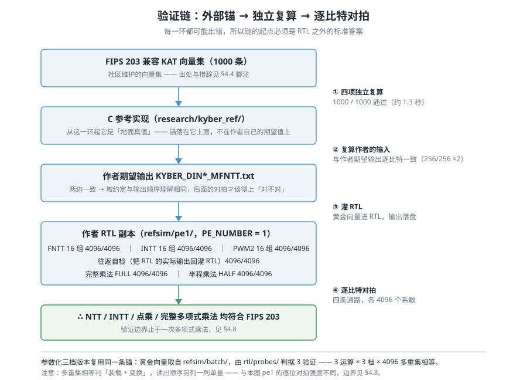
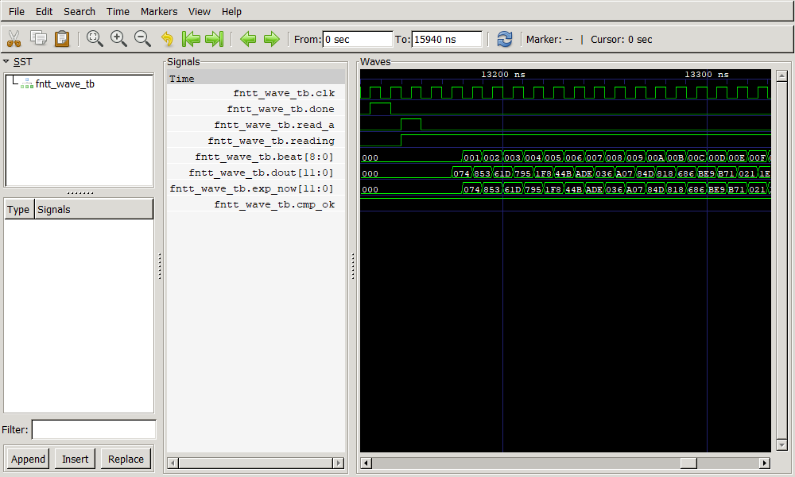
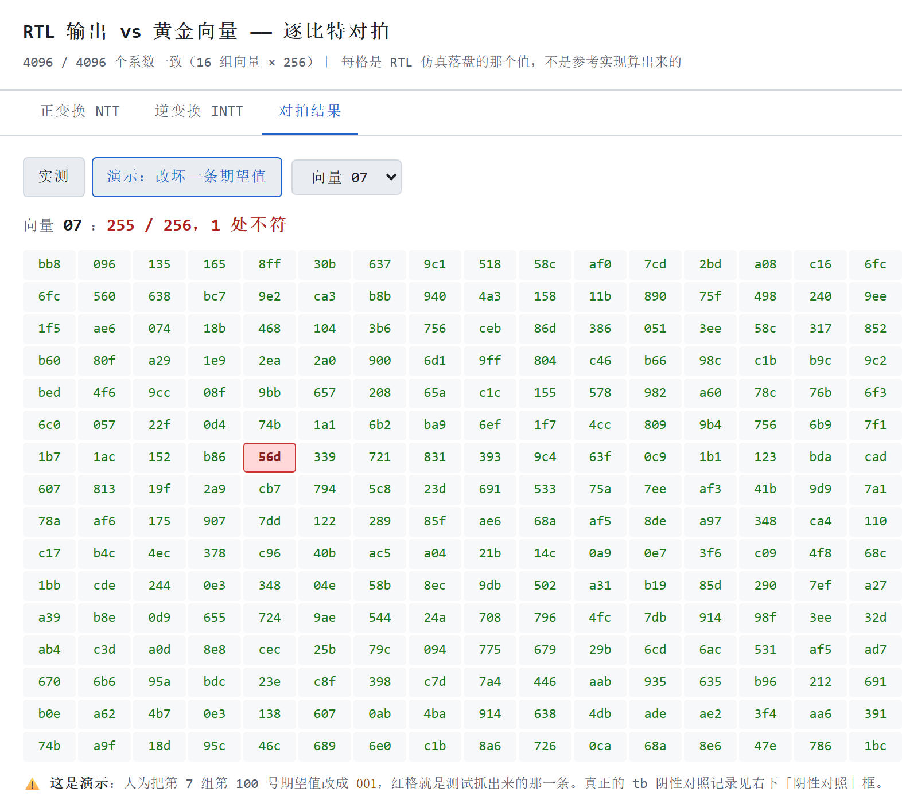

# 四、功能正确性

> **状态**：🔄 **初稿（2026-10-01；上板端到端 2026-10-04 补；H5 波形与三档完整乘法回归 2026-10-18 补；ML-KEM trace 回放与变异测试 2026-10-20 并入 §4.11）**。**上游基线（pe1）** 的证据已在仓库（`../../refsim/`，
> B 主责）；**参数化三档** 的部分来自 `../../rtl/probes/`（A 主责）；
> **真板子端到端**（§4.8）来自 `../../rtl/vivado/reports/board_pe{1,4,16}_txn.txt`（10-18 当前驱动；10-04 历史件另注）。
> **2026-10-18 补**：B 的 H5 已交付 —— 参数化三档 FULL/HALF 仿真回归（§4.6 末）与
> FNTT 波形图（§4.4 末）已入正文；波形**只覆盖上游 pe1 单组**，边界见两处说明。
>
> 对应评分项：**功能正确性 20 分**。本章每个数都能指到 `refsim/README.md` 或
> `rtl/probes/README.md` 里的具体一节。
>
> ⚠️ **验证边界与结论同等重要**，本章 §4.9 单列 —— 权威说明在 `../../refsim/README.md` §八。

---

## 4.1 一句话

我们的验证不是「跑通了作者的 testbench」，而是**另起一条以 FIPS 203 为终点的链**：
1000 条 KAT 锚住 C 参考实现，参考实现锚住作者 RTL，RTL 再逐比特对拍
**NTT / INTT / 点乘 / 完整多项式乘法**四条通路（各 4096 个系数）；
参数化三档版本复用同一条锚，**3 运算 × 3 档各 4096 个系数**多重集全中；
**完整乘法**另有 3 档 × FULL/HALF 的仿真回归（**24,576 个系数**，§4.6 末）。
最后**上真板子**再验一遍：三档 × 五条计算事务，每条都是黄金向量逐值 **256/256 全中**（§4.8）。
此外，用一条**真实 ML-KEM-768 密钥交换轨迹**里的 15 次 NTT 在三档 RTL 上回放（§4.11），
并用 17 个变异体检查测试本身能不能抓错。

---

## 4.2 判「对」的三条规矩

**规矩一：锚必须在被测对象之外。**
作者的 testbench 是拿**作者自己给的期望输出**比**作者自己的 RTL** —— 只能证明自洽。
万一期望值本身就错了（twiddle 表排错、域约定选错），testbench 照样打印 `Correct!`。
所以链的起点是 FIPS 203，不是作者的 `.txt`。

**规矩二：中间必须有一环独立复算。**
参考实现（`research/kyber_ref/`）是被测 RTL 之外的另一份实现。它复算作者的输入，
两者逐比特一致 —— 这既证明作者的数据没错，也证明我们对域约定与输出顺序的理解
和作者相同。**否则后面拿自己的向量去灌 RTL，顺序对不上会假报失败。**

**规矩三：「通过」必须配「非退化」和「阴性对照」。**
灌进去的向量如果全是 0 或常量，「全中」可能只是巧合；一个永远通过的测试没有价值。
所以每一项都额外做两件事：统计向量里有多少个**不同值**（§4.4 表），
以及**故意改坏一处**，看测试抓不抓得住（§4.7 汇总）。

---

## 4.3 验证链



**这张图说明什么**：链上每一环都可能出错，所以**箭头方向是「锚」的方向，不是「数据流」的方向** ——
数据从左上往下走（向量喂进 RTL），可信度从下往上传（RTL 的正确性只能由它上面的锚背书）。
中间那一环（作者期望输出 == 参考实现）不能省：跳过他，就没法区分
「RTL 算错了」和「我们喂数据的顺序和作者不一样」。

链的四个入口都在 `../../refsim/`：

```sh
sh run_fntt_check.sh          # ① NTT 全流程：KAT → 参考实现 → RTL
sh run_intt_pwm2_check.sh     # ② INTT + 点乘 + 往返自检
sh run_polmul_check.sh        # ③ 完整多项式乘法（端到端）：FULL + HALF
sh run_ntt_layers.sh          # ④ 导出并机器验证 twiddle 层序表
```

---

## 4.4 上游基线 pe1：四条通路各 4096/4096

`PE_NUMBER = 1` 的上游基线（`../../research/ref_rtl/kyber-polmul-hw/pe1/` 的副本）实测：

| 通路 | 内容 | 结果 |
|---|---|---|
| **KAT** | 1000 条向量，KeyGen / Encaps / Decaps / 隐式拒绝**四项互相独立**的复算 | **1000 / 1000** |
| FNTT | 16 组黄金向量灌进 RTL | **4096 / 4096** |
| INTT | 16 组 | **4096 / 4096** |
| PWM2（点乘） | 16 组 | **4096 / 4096** |
| 往返自检 | 把 RTL 的 FNTT **实际输出**灌回 RTL 的 INTT | **4096 / 4096** |
| 完整乘法 FULL | FNTT(A) → FNTT(B) → PWM2 → INTT | **4096 / 4096** |
| 半程乘法 HALF | FNTT(A) → PWM2 → INTT | **4096 / 4096** |

「完整乘法」这一条最能说明问题：它**时域进、时域出、链上没有任何缩放因子**，
期望值就是参考实现的输出，逐比特直接比。这两个常数因子（点乘的 R、INTT 的 R⁻¹）
在链上正好抵消 —— 所以这一组全过，反过来给单运算那一层的标定做了背书：
**若 R 或 R⁻¹ 有一个标错了，端到端这两组不可能严丝合缝地全过。**

> **KAT 的出处要说清楚**（答辩可能被追问）：这 1000 条**不是 NIST 官方发布的文件**，
> 而是社区仓库 `post-quantum-cryptography/KAT` 维护的 FIPS 203 兼容向量集。
> 措辞应为「**社区维护的 FIPS 203 兼容向量集，已由参考实现独立复算验证**」，
> 不要说成「NIST 官方 KAT」—— NIST 官方走 ACVP（JSON 格式，面向算法验证系统）。
> 之所以仍然可信：一份错误的向量集不可能让独立实现四项全中。
> 详见 `../../research/mlkem_kat/README.md` 文首警告。

### 非退化统计：每个文件 16 组 × 256 = 4096 个系数，输入不是常量

| 向量集 | 行数 | 不同值 | 最常见值占比 |
|---|---:|---:|---:|
| `intt_batch_in` | 4096 | 2374 | 0.15% |
| `intt_batch_exp` | 4096 | 2355 | 0.17% |
| `pwm2_batch_a` | 4096 | 2374 | 0.15% |
| `pwm2_batch_exp` | 4096 | 2371 | 0.22% |
| `fullmul_a` / `_b` | 4096 | 2355 | 0.17% |
| `fullmul_exp` | 4096 | 2357 | 0.20% |
| `halfmul_b` | 4096 | 2374 | 0.15% |
| `halfmul_exp` | 4096 | 2357 | 0.20% |

值位于 **0..3328**（模数 q = 3329 的合法范围），无越界；每个文件 16 组合计 4096 个系数里有
2300 多个不同的值，最常见的值也只占 0.2% —— 输入与答案的多样性足以排除「常量向量全中」
这种退化情形。这不是严格概率证明，但配合 §4.7 的阴性对照，说明测试有分辨力。

### 波形逐拍核对（2026-10-17 补，B）



**这张图是什么**：上游基线 `pe1` 的 FNTT，**第 0 组黄金向量**，把 RTL 每拍输出
与期望值并排画在同一条时间轴上；读出窗口内 **256 拍逐拍相同（256/256）**。
源 `../../refsim/pe1/fntt_wave_tb.v`，入口 `python refsim/run_wave_check.py --render-svg`，
VCD 与比对结果由脚本重新生成，不是截图后手改的。

> ⚠️ **边界（引用时必须带上）**：这张图**只代表上游 pe1 的 FNTT 第 0 组**，
> **不能**贴成「三档 FULL/HALF 的波形」，也不能代表 INTT / 点乘。
> 三档完整乘法的证据是下面 §4.6 的仿真回归与 §4.8 的上板事务，不是这张图。

---

## 4.5 域约定：对拍「全错」不等于 RTL 有 bug

这是本项目排查过程中最有价值的一条经验，报告里写出来，因为它同样是**方法**：

第一次拿参考实现的 INTT / 点乘输出**直接**当期望值去比，16 组**全部** `0/256`。
看上去像 RTL 坏了，其实是两边对「这个函数的输出该不该带 Montgomery 因子」理解不同：

| 运算 | RTL 输入域 | RTL 输出 与 参考实现的关系 |
|---|---|---|
| INTT | NTT 域 | RTL = `poly_invntt_tomont(x)` × R⁻¹（真逆变换，无 tomont 缩放） |
| PWM2 | NTT 域 | RTL = `poly_basemul_montgomery` × R（少一级 Montgomery 归约） |

R = 2¹⁶ mod q = **2285**，R⁻¹ = **169**。

**怎么定位的**：不看「通不通过」，改看**比值**。逐系数相除，比值集合大小为 1
（而不是 248 种随机值）—— 说明逻辑没错，只差一个全局常数因子。
这一步同时排除了「点乘被误当成逐系数乘法」这类真正的功能错误。

**怎么确认这个因子不是自我安慰**：`run_intt_pwm2_check.sh` 第 ④ 步做**往返自检**，
把 RTL 的 FNTT **实际输出**灌回 RTL 的 INTT，要求回到时域原值。
这条路**完全不经过 C 参考实现**，也就不可能被「我们自己标定的因子」带偏 ——
它只依赖「FNTT 已经验过」，是把单运算那一层钉死的最后一道钉子。

> **教训**：对拍全错时，先算比值再怀疑逻辑。恒定比值 = 约定问题；
> 杂乱比值 = 功能问题。两者的排查方向完全不同。

---

## 4.6 参数化三档：3 运算 × 3 档各 4096/4096

上面验的是**上游基线 pe1**。我们改造出的参数化版本（`PE_NUMBER` 可配 1 / 4 / 16）
复用**同一条锚** —— 黄金向量取自 `refsim/batch/`（已由 KAT 校验过的参考实现算出），
由 `rtl/probes/run_probes.sh` 段 ⑩（**判据 3**，功能对拍）验证：

| 运算 | pe1 | pe4 | pe16 |
|---|---|---|---|
| FNTT | 4096/4096 | 4096/4096 | 4096/4096 |
| INTT | 4096/4096 | 4096/4096 | 4096/4096 |
| PWM2 | 4096/4096 | 4096/4096 | 4096/4096 |

**判定口径要写清楚**：这一层用的是**多重集相等** —— 输出的 256 个值作为集合
等于黄金向量（顺序对了必然成立），**读出顺序只影响先后、不影响集合**。
顺序被单独量出来列在右边，并由 §4.9 说明为什么不统一。

**改动了 RTL，为什么还能沿用 pe1 的结论？** 因为改造是**逐拍等价**的，有探针背书：

- `ag_equiv_tb.v`：新的 `ntt_addressgenerator` 与上游 `addressgenerator`，
  同一份激励喂两边，**每个时钟沿比 18 路输出**，三档逐拍全等。
- `core_equiv_tb.v`：新的 `KyberHPMNTT` 与上游 `KyberHPM{1,4,16}PE`，
  每个时钟沿比**全部端口 + 全部内部状态**（三档分别 39 / 111 / 399 路），三档逐拍全等。

也就是说：**新核与上游老核跑出同样的每一拍**，而老核已经由 §4.4 的链验过。
「等价」+「老核已验」两条合起来，才是三档能继承结论的依据。

**顺带一条内部交叉验证**：判据 2（周期数）覆盖**九个（档位、运算）组合**
（FNTT 904/232/69、PWM2 647/167/47、INTT 904/233/71），与上游基线实测值逐个相同；
FNTT 另有纯 FNTT 路与 PWM2 路两处各量一次，作路径交叉验证。

### 参数化核的完整乘法仿真回归（三档 × FULL/HALF，2026-10-17 补，B）

上面 §4.6 的三档对拍是**单运算**（FNTT / INTT / PWM2），走 `rtl/probes/`。
这一条补的是**完整乘法**在三档上的**仿真**回归，对象是参数化核 `rtl/ntt_core` 本身
（不是把上游 pe1 的参数名改一下）：

| 项 | 结果 |
|---|---|
| 规模 | 3 档 × 2 模式（FULL/HALF）× 16 组 × 256 系数 = **24,576 个系数** |
| 判定 | 多重集 **4096/4096**；按 τ 顺序逐项 **4096/4096**（FULL / HALF、pe1/pe4/pe16 六格全过） |
| 参考值来源 | 本次**重新编译 C 参考程序、重新计算**，不复用冻结期望值 |
| 非退化 | FULL：A/B 各 **2355** 个不同值；HALF：A/B **2355 / 2374** —— 输入非退化且 A ≠ B |
| 阴性 ①：B 装载顺序错 | 多重集塌到 **334 / 4096**，被拒 |
| 阴性 ②：改坏一个期望系数 | **4095 / 4096**，恰好一处不符，被拒 |
| 阴性 ③：缺 `CFG_PE_NUM` | **仿真启动时 FATAL**（`$fatal` 在 `initial` 中触发），被拒（配错档不能静默能跑） |

入口是新增脚本（**原有 6 条 `refsim/` 入口未改**）：

```sh
sh refsim/run_polmul_param_check.sh
# 或直接看带阴性对照的版本
python refsim/check_polmul_param.py --negative-controls
```

原始输出在 `../../logs/verification_2026-10-17_B_clean_clone.json` 的
`parameterized_polmul` 一步（同一台电脑从 Gitee 全新 clone 后跑的，**不是** H10 换机验收）。

> ⚠️ **这一条不能替代上板**：它只证明参数化核在仿真里与重新计算的参考实现一致；
> 真器件上的端到端仍是 §4.8（三档 × 五条事务 256/256，来自真板子）。

---

## 4.7 阴性对照汇总：证明这些测试有牙齿

一个永远通过的测试没有价值。以下每一条都是**故意改坏一处**，看测试是否必报错。

| 层 | 改哪里 | 预期 | 实测 |
|---|---|---|---|
| 参考实现链 | 把第 7 组第 100 号期望系数改成 `001` | 恰好 1 个不符、位置正确 | `向量 7 [100]: 期望 001 得到 3d4`、`255/256`、`共 1 个系数不符` |
| 三档功能对拍 | 把 pe4 的 PWM2 装载顺序拨成 σ | 多重集塌成随机命中 | **~22 / 4096** |
| 逐拍等价（AG） | FNTT 读地址 `(L-1-c_stage)` → `(L-2-c_stage)` | 三档全 FAIL | 2712 / 2984 / 2826 处 |
| 逐拍等价（AG） | pe16 分支 `STL0` 条件去掉 | **只有 L=3 FAIL**，L=7/5 仍 PASS | 符合 |
| 逐拍等价（核） | 共享骨架 `do0_lo` 改读 `do0[dg]` | 三档全 FAIL | 384 / 96 / 24 |
| 逐拍等价（核） | pe16 装载写地址高位取反 | **只有 PE=16 FAIL** | 19091 |
| 例化期守卫 | `TW_ADDR_W` 配错档（pe4 + `TW=9`） | FAIL（配错档能编能跑，会静默读飞） | 符合 |
| 例化期守卫 | `PE_NUMBER = 3` | FATAL（非法配置必须响亮失败） | 符合 |

第一行还带一个正面信号：RTL 报出的 `3d4` **正是原值** —— 说明 RTL 是对的，
测试也确实能把错抓出来。最后两行的意义不同：它们拦的是**例化 / 仿真启动期**的错配，
不等到跑完才发现。两者的失败阶段并不相同：`TW_ADDR_W` 配错档在 **elaboration 期**
被工具拒绝；`PE_NUMBER = 3` 在 iverilog 下**编译不报错**（只有越界警告），
要到 **`vvp` 启动**时由 `initial` 里的 `$fatal` 报出 —— 判据是看 `FATAL` 那一行，
不是看编译器退出码。



> **这张图说明什么**：上表**第一行**的现场版（截图取自演示页的阴性对照按钮，
> 浅色主题，`?theme=light`）。把第 7 组第 100 号的期望值改坏一条，
> 网格里**恰好 1 个红格**、状态行从 `256/256 全中` 变成 `255/256，1 处不符`。
> **红格的个数是脚本数出来的，不是看出来的** —— `demo/gen_shots.mjs` 在截图前
> 断言 `#grid` 里的红格数（这一版要求 1，截图版要求 0），不符就退非零、不出图。
> 缩小后的截图目视数红格是不可靠的（两个红格可能被看成一片）。
> 一个永远通过的测试没有价值；这一格说明**这个测试有牙齿**。

---

## 4.8 真板子端到端：三档 × 五条事务各 256/256（2026-10-04 首测；2026-10-18 当前驱动复跑）

上面 §4.4–§4.6 都是在**仿真或工具**里验的。这一节是**上真板子**：
PC → 串口 → 板级 wrapper（协议状态机 + 行组装）→ NTT 核 → 串口 → PC 一整趟，
比的对象是**黄金向量第 0 组**。

五条计算事务，三档各跑一遍。**10-18 当前驱动的原始日志**是
`rtl/vivado/reports/board_pe{1,4,16}_txn.txt`；**10-04 那一版**只有 pe4 / pe16 的摘要入库
（`board_pe{4,16}_txn_2026-10-04.txt`），pe1 的原始串口日志当时未入库。

| 事务 | 是什么 | pe1 | pe4 | pe16 |
|---|---|---|---|---|
| `#NTT` | 正向变换 | 256/256 | 256/256 | 256/256 |
| `#INTT` | 逆向变换 | 256/256 | 256/256 | 256/256 |
| `#PMUL NTT` | 点乘（A/B 都在 NTT 域） | 256/256 | 256/256 | 256/256 |
| `#PMUL TIME` | 点乘（A 时域、B NTT 域，半乘） | 256/256 | 256/256 | 256/256 |
| `#PMUL FULL` | 点乘（A/B 都时域，全乘） | 256/256 | 256/256 | 256/256 |

**每条都带非退化对照**：同一份向量**原样回显**必须得 **0/256** —— 实测三档五条全 0/256。
日志同时记录输入里有多少个不同值（239 ~ 476 个），排除「向量是常量、全中只是巧合」。

> ⚠️ **装载/读出顺序按 (运算, 折叠度) 分档**（FNTT 自然序｜INTT 交织｜PWM2 按档 …）。
> 这是**上位机的责任**，不是核的 bug —— 核的 `load_*` 口是顺序写 BRAM。
> 完整口径在 `../../rtl/H1_port_spec.md` §五 与 `../../logs/letter_2026-10-04_A_to_BC_board.txt`。

**这一节补上了原来「未覆盖」的两条**：**pe4 / pe16 的完整乘法端到端**（`#PMUL FULL` 三档都过），
以及**真器件**（前面所有数字都是仿真或工具值，这里是真板子）。

⚠️ **一处措辞要精确**：`#PMUL NTT` **那一条**用的黄金向量是 `pwm2_batch_a == pwm2_batch_b`，
所以**这一条**实际测的是**平方**。但**「两个 bank 装不同数据」是测过的** ——
`#PMUL TIME` / `#PMUL FULL` 喂的就是两份不同的多项式：FULL/HALF 的**每一组 A、B 多项式都不相同**
（FULL 的 4096 个位置中有 2 个值相等，但 16 对多项式没有一对完全相同；HALF 没有相等位置），
10-04 那一版三档各五条计算事务 **5/5**、各 **256/256** 全过。
⚠️ **上表是 2026-10-04 那一版的结果**：**pe4 / pe16 的历史摘要**现另存
`board_pe{4,16}_txn_2026-10-04.txt`；**pe1 那一版的原始串口日志当时未入库**
（驱动脚本写在仓库外，数字见 `../../logs/project_state.md` §一）。
✅ **2026-10-18 复跑：三档各 6/6**（当前驱动，原始日志
`../../rtl/vivado/reports/board_pe{1,4,16}_txn.txt`）：
`#PING` 成功；`#NTT 1` / `#INTT 1` / `#PMUL NTT 1` / `#PMUL TIME 1` / `#PMUL FULL 1`
五条计算事务各 **256 个系数零差异**，合计 **6/6 成功**（PING 只核对协议应答，不做系数比较）。
10-15 那次的 `#PMUL TIME 1` ❌ 是上位机读
`halfmul_b.txt` 的变长格式（`../../host/KNOWN_ISSUES.md` B2），**不是核算错**；
2026-10-17 补零修好向量与生成器后，三档全过。旧 5/6 报告留底
`board_pe1_txn_2026-10-15_5of6.txt`。
⚠️ **提频版同样做了**：pe1 80 / pe4 75 / pe16 62.5 MHz 各 6/6（同样是 `#PING` + 五条计算事务；`..._f{80,75,62.5}_txn.txt`）。
⚠️ 三档读出顺序不统一（FNTT 读数路：pe1 = 交织，pe4/pe16 = 自然序）—— 见 §4.9，与功能结论无关。

---

## 4.9 本章的边界（没验什么，为什么）

写清楚边界比含糊地说「验证充分」有用 —— 被追问时不被动。

| 没覆盖 | 说明 |
|---|---|
| **更外层的运算** | 验证边界**止于一次多项式乘法**。`polyvec_basemul_acc_montgomery`（累加多个点乘）、base case 乘法（Karatsuba 那步）、`poly_tomont` / `poly_reduce` 归位**均未验** —— 仓库里没有对应的 RTL，没有可验对象（见 `../../refsim/README.md` §八） |
| **KAT 只锚到参考实现** | KAT 的字段是 KEM 级的（pk/sk/ct/ss），一个只有 NTT 的模块既吃不进也吐不出。所以 KAT 用来锚**参考实现**，NTT 核由参考实现的输出锚 —— 上板端到端跑 KEM 是更外层的事 |
| ~~**参数化版的完整乘法端到端**~~ | ✅ **两条路都已覆盖**：仿真见 §4.6 末（三档 × FULL/HALF，24,576 系数，§4.6 的阴性对照齐全）；真器件见 §4.8（`#PMUL FULL` 三档各 256/256）。⚠️ 两条路的被测对象不同：仿真针对 `rtl/ntt_core`，上板是板级 wrapper + 核整条链 |
| **三档读出顺序不统一** | FNTT 读数路：pe1 = 交织 σ，pe4/pe16 = 自然序（INTT / PWM2 三档一致）。**这是接口的事，不是功能的事** —— 多重集判据不含顺序，所以功能结论不受影响。已作为 H3 协议缺口单独记录 |
| ~~**真实 ML-KEM trace 送板**~~ | ✅ **2026-10-21 已完成**：三档各 15 次 / 3840 系数，合计 **45 次 / 11520 系数**逐项一致（COM9，50 MHz 基线位流，逐档烧录；`../../logs/verification_2026-10-21_A_kem_serial_pe{1,4,16}/`）。**2026-10-29 又补 count=1/2 三档 90 次 / 23,040 系数**（`../../logs/verification_2026-10-29_A_kat{1,2}_pe{1,4,16}/`），真板合计 **135 次 / 34,560 系数**。原「送板工具只做过模拟场景测试」已由实板执行补上 |
| **常数时间 / 侧信道** | §4.11 的固定周期与变异测试只说明已观察的调度与有效访存序列不随输入变；**不是形式化证明**，也不是功耗/电磁侧信道安全证明，不代表整套 ML-KEM 固定时间 |
| **方差 / 时序 / 功耗** | 本章是功能验证，不是实现质量评估；面积与频率在 `03_performance_and_resources.md` |
| ~~**波形截图**~~ | ✅ **已补（2026-10-18）**：§4.4 末，源 `refsim/pe1/fntt_wave_tb.v`。⚠️ **只覆盖上游 pe1 的 FNTT 第 0 组**，不代表三档 FULL/HALF，也不代表 INTT / 点乘 |

另外两条**已知的、不影响结论的**小瑕疵，一并写出来：

- 作者自带的 testbench 数据**只对了 2 组**，样本量小；我方补的 16 组是主力。
- 作者的 INTT testbench 里有个**打印 bug**：报错那行的 `$display` 把 `doub[m]`
  写成了 `doua[m]`（`pe1/KyberHPM1PE_test_INTT.v` 第 227 行）。只在失败时才打印，
  不影响结论，但真出问题时会把排查带偏。

---

## 4.10 数据溯源

| 内容 | 出处 |
|---|---|
| 验证链、四条通路结果、非退化统计、阴性对照 | `../../refsim/README.md` §一 / §三 / §七 |
| 三档 × FULL/HALF 完整乘法仿真回归（§4.6 末） | `../../refsim/run_polmul_param_check.sh`、`../../refsim/check_polmul_param.py`；原始输出 `../../logs/verification_2026-10-17_B_clean_clone.json` 的 `parameterized_polmul` |
| FNTT 逐拍波形（§4.4 末） | `../../report/figures/refsim_wave_fntt_compare.png`；源 `../../refsim/pe1/fntt_wave_tb.v`；入口 `../../refsim/run_wave_check.py` |
| 验证边界（§4.9） | `../../refsim/README.md` §八 |
| 上板端到端（§4.8，2026-10-18 当前驱动） | `../../rtl/vivado/reports/board_pe{1,4,16}_txn.txt`；提频版 `board_pe{1,4,16}_f{80,75,62.5}_txn.txt` |
| 上板端到端（§4.8，2026-10-04 历史版） | `board_pe{4,16}_txn_2026-10-04.txt`；pe1 原始串口日志当时未入库，数字见 `../../logs/project_state.md` §一 |
| KAT 1000/1000 与出处措辞 | `../../research/mlkem_kat/README.md` §一 / 文首警告 |
| 域约定与往返自检 | `../../refsim/README.md` §七 |
| 三档功能对拍（判据 3）、逐拍等价、三档阴性对照 | `../../rtl/probes/README.md`（`core_equiv_tb.v` / `ag_equiv_tb.v` / `ntt_func_tb.v` 三节 + 「判据」） |
| 三档周期数（判据 2） | 同上，`top_golden_tb.v` 一节 |
| 判据编号的对应关系 | `02_design_and_innovation.md` §2.6（本章的「判据 3」= 功能对拍） |
| ML-KEM trace 回放（§4.11.1） | `../../refsim/accept_trace_delivery.py`；证据 `../../logs/verification_2026-10-18_B_kem_delivery.{json,md,zip}`、`..._rtl.json`；说明 `../../refsim/trace_delivery_README.md` |
| 变异测试与固定周期（§4.11.2） | `../../refsim/accept_strengthening.py`；证据 `../../logs/verification_2026-10-18_B_strengthening.{json,md,zip}`；说明 `../../refsim/strengthening_README.md` |

**可复跑**：`refsim/` 的四个入口脚本 + `rtl/probes/run_probes.sh`；
§4.11 另有 `python refsim/accept_trace_delivery.py --output <目录>` 与
`python refsim/accept_strengthening.py --output <目录>`。
需要 `gcc` / `iverilog` / `python`（见 `../../refsim/README.md` §二）。

---

## 4.11 ML-KEM 真实输入回放与变异测试（2026-10-18 补，B）

前面的向量都是批量的独立多项式。这一节回答两个不同的问题：
① 把 ML-KEM 真的跑出来的 NTT 输入喂给核，三档都对吗？
② 测试本身有没有牙齿 —— 故意把 RTL 改坏，抓得住吗？

### 4.11.1 从一条真实 KEM 轨迹回放 15 次 NTT

从一次完整的 ML-KEM-768 密钥交换（keygen / encaps / decaps = 6 / 3 / 6）中
提取出 **15 次正向 `poly_ntt` 调用**，固定成 trace（SHA-256 `e107dc71…bfd59f`），
分别在 pe1 / pe4 / pe16 的**实际 `rtl/ntt_core`** 上回放：

| 检查 | 结果 |
|---|---|
| 三档回放 | 各 15 次、共 **45 次**；**11,520 个系数逐项全对** |
| 外层周期 | 907 / 235 / 72 拍；按既有接口约定扣 3 拍流水线 → 核 **904 / 232 / 69** |
| RTL 负向 | 每档的错误期望、未知值、重复行、缺完成标志**全部被拒** |
| Host 批量与逐行 | 240 批量 + 240 逐行 = 480 事务、122,880 系数；字节流与结果一致（**模拟传输**） |

⚠️ **边界**：§4.11.1 的 45 次回放是**实际 RTL 仿真**；**2026-10-21 又补了真板**
（count=0，45 次 / 11,520 系数），**2026-10-29 再补 count=1/2 两份（各 15 次 × 三档
= 90 次 / 23,040 系数）** —— 真板合计 **135 次 / 34,560 系数**逐项一致（COM9，50 MHz 基线位流，
逐档烧录；`../../logs/verification_2026-10-29_A_kat*_pe*/` 与
`../../logs/verification_2026-10-21_A_kem_serial_pe{1,4,16}/`）。
真板那段**不含**长时间压力测试与误码率统计；频率 50 MHz 是人工声明。trace 基于社区维护的
**FIPS 203 兼容** KAT，不是 NIST 官方向量。

### 4.11.2 变异测试：17 个变异体全部被抓

在 `rtl/ntt_core` 的**副本**上逐个人为注入故障（不改仓库原件），
每个变异单独编译、正常跑完仿真：

| 检查 | 结果 |
|---|---|
| 变异体捕获 | **17 / 17**（16 个数值错误 + 1 个输出 X） |
| 基线 | pe4 / FULL、16 组输入 **4096 / 4096** |
| 固定周期 | 每档 **103 次**输入（100 随机 + 3 边界），周期恒为核 **904 / 232 / 69** 拍 |
| 有效地址序列 | 同档 103 次完全相同（读地址、twiddle、写使能逐拍比；写地址只在写使能为 1 时比） |
| 负向保护 | 改坏一个答案 → 4095 / 4096；旧输出目录被拒；工具超时被拒并保留部分日志 |

⚠️ **10-18 当时边界**：变异只覆盖 **pe4 / FULL**（10-21 扩展见 §4.11.3），不能外推成「所有档位所有运算的变异覆盖率 100%」；
固定周期描述的是**已观察的调度与有效访存序列**，不是形式化证明，也不是侧信道安全结论。
复位后首次运算开头的 8 拍里，闲置的写地址线存在残留状态差异，但对应写使能为 0；
后续 102 次的原始地址线序列彼此一致。


### 4.11.3 证据广度扩展（2026-10-21，B）

保留前两节的历史测试，另扩三档样本与故障组合，原始证据不覆盖。

| 项目 | 本轮结果 | 范围 |
|---|---|---|
| NTT 样本 | 每档 100 组 / 25,600 系数，三档 76,800 系数一致；各档改错一项恰好发现一处 | 原 16 + 新 84，seed=20261021；新样本含 0、q−1、q、负数代表值；先独立 C 有符号计算对照取模结果，RTL 接收 0..3328 |
| 三个 transcript | 社区兼容 KAT count=0/1/2，公钥与 trace 哈希各不相同；三档共 135 次 / 34,560 系数 RTL 逐项一致 | 正常 KEM 的正向 NTT；不是整套 KEM 硬件。真板已同步到同一口径：count=0 45 次 + count=1/2 90 次 = **135 次 / 34,560 系数**（10-29） |
| 三档 FULL 变异 | 三档变异共 50/51 捕获（pe1/pe4/pe16=16/17/17），另 1 项 pe1 serializer_order 等价，不计捕获。 | 每组合 16 组，三档未修改基线均通过；编译失败/超时不计捕获；不外推 HALF 或全故障空间 |

pe1 的 `serializer_order` 修改输出 lane 选择式，但单 lane 的 `rsub` 恒为 0，原式和变异后都选 lane 0；因此属于等价项。不能写成 51/51 捕获。

独立 JSON 见 `../../logs/verification_2026-10-21_B_phase2_{ntt100,traces,mutations}.json`；逐项故障表见同前缀 `_mutations.md`；原始命令、仿真输出、输入与源快照见 `../../logs/verification_2026-10-21_B_phase2.zip` 及 `_manifest.json`。复跑：`python refsim/accept_b_current.py --output <新目录>`。本轮未新增板卡执行；固定周期与侧信道结论维持 §4.11.2 的有限边界。

### 4.11.4 独立数学复核与本机收尾（2026-10-29）

新增 `refsim/check_independent_polmul.py`，直接用整数双重循环计算模 `x^256+1`、
模 3329 的卷积，不调用 C NTT、basemul 或逆变换作为答案。16 组输入覆盖零、单位元、
最高次单项式绕回负号、q−1 及固定种子随机多项式；三档实际 FULL RTL 共
**12,288 系数全部一致**，改坏一个值、绕回符号及输出顺序均被检出。
FULL 的结果为规范时域值，读出按既有 tau 排列还原；不扩张 HALF、完整 KEM 或侧信道结论。
证据：`../../logs/verification_2026-10-29_B_math.json`。

同日复跑完整 B 验收：三档各 100 组 NTT、三份 trace、51 个变异组合，仍为
**50 个检出、1 个等价项**；全部 **12 个 Host 自测**与送板编排检查通过。
干净远端克隆另跑 **22 阶段**全部通过，源码候选实际解压并逐文件校验哈希后，
包内 CLI 检查通过。自动执行不替代本人手动验收或第二台实体电脑验收。

验证侧另核对六个新增真板 session 的 trace 哈希、原始数据重新解包、逐项期望值及位流身份，
新增 90 次记录通过；冻结 count=0 的重复回放另列，不累计成更多独立样本。
对应 `../../logs/verification_2026-10-29_B_board_review.json` 与 `_freeze_board_review.json`。
本日后续 CLI 关闭/摘要修补有本机检查，不能追认成较早真板运行的提交。
