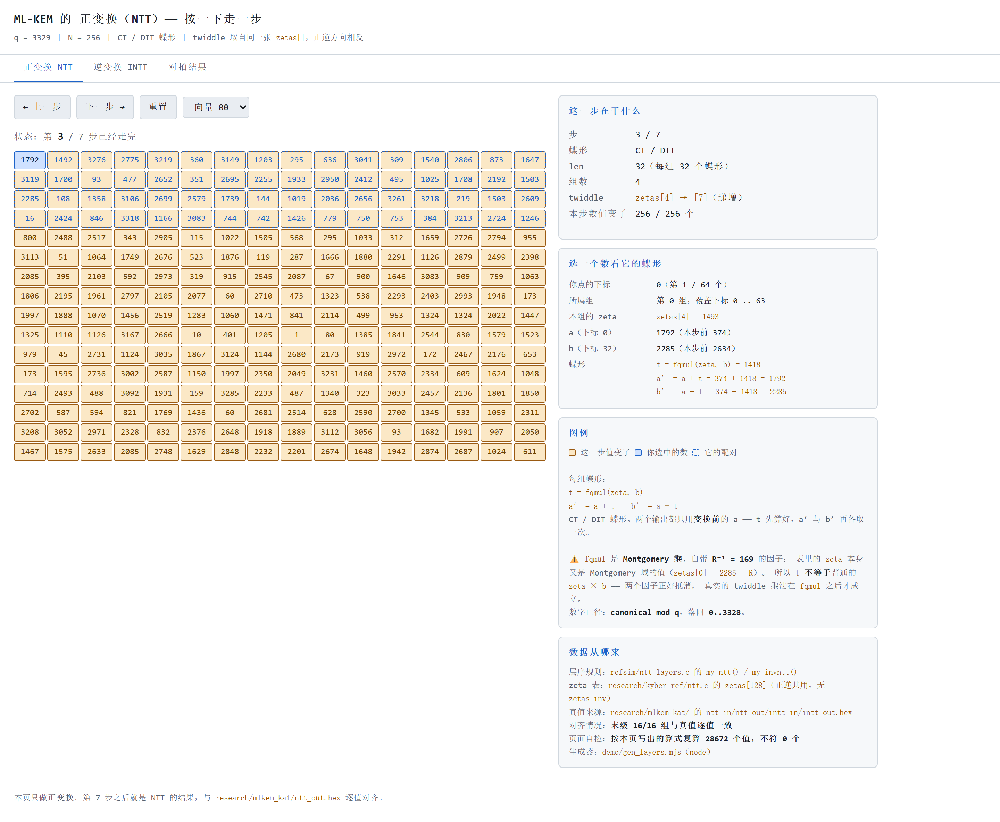
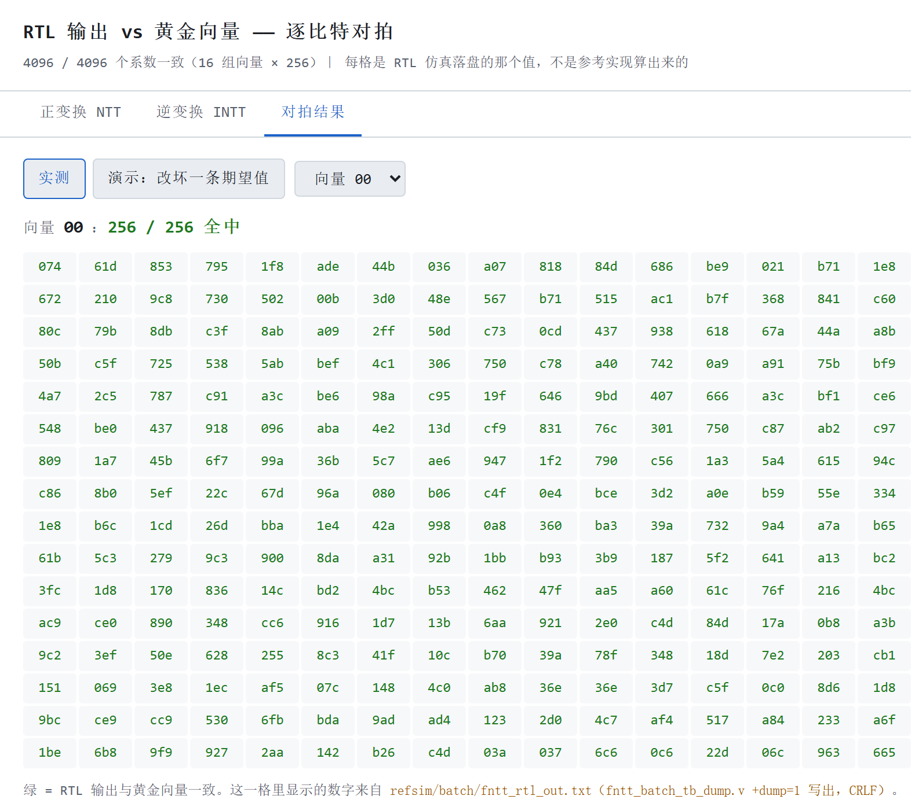

# 五、可复现性

> **状态**：🔄 **初稿（2026-10-01）**。对应评分项：**文档与可复现 15 分**。
> 本章讲「**别人 clone 下来，几步能跑通**」—— 评委拿到这个仓库之后，能不能复现我们的结论。
> 复现步骤的权威版本在仓库根 `README.md` §三；本章把它讲清楚，并交代**哪些能复现、哪些不能**。

---

## 5.1 一句话

复现分**两档**，都只需要「clone + 一条命令」量级：

- **看结论**（零工具链）：双击一个网页，看 NTT/INTT 逐层动画与 4096 格对拍全绿；
- **跑结论**（装 4 个工具）：三条命令，自己从 FIPS 203 考题复算到 RTL 对拍。

而且「能复现」不是一个承诺，是一件**被验过的事** —— 用一个零依赖脚本，
在干净临时目录里全新 clone 再从零跑，跑不过就退非零。

---

## 5.2 两档各要什么

| 档 | 想看到什么 | 要装什么 | 最短几步 |
|---|---|---|---|
| **A · 看结论** | 演示页（逐层动画 / 对拍 4096 格）、报告正文、指标表 | 只要浏览器 | **1 步**（双击 `demo/index.html`） |
| **B · 跑结论** | 自己复算一遍 KAT → 参考实现 → RTL 的对拍 | `git` + `gcc` + `python 3` + `iverilog 12.0` | **2 步**（`git clone` → `sh run_fntt_check.sh`） |

（「几步」按最短路径算，不含装工具。）第 B 档才是复现**验证结论**，A 档是复现**展示结论** ——
两者都写出来，是因为「评委只有浏览器」是真实会发生的场景。

---

## 5.3 B 档：跑验证链

```sh
git clone <仓库地址> FPGA
cd FPGA/refsim

sh run_fntt_check.sh          # ① NTT 全流程：KAT → 参考实现 → RTL
sh run_intt_pwm2_check.sh     # ② INTT + 点乘 + 往返自检
sh run_polmul_check.sh        # ③ 完整多项式乘法（端到端）：FULL + HALF
```

另有一个辅助脚本 `sh run_ntt_layers.sh`（导出并机器验证 twiddle 层序表），
不属于三条主链，但同样自包含。

**三条主脚本都是全自动的**，预期输出见 `../../refsim/README.md` §三
（满屏 `4096/4096`、`✅ 16 组全过`）。两个让「换台机器也能跑」的设计：

- 脚本用 `$(dirname "$0")` 定位自己，**不写死绝对路径**；
- `iverilog` 不在 PATH 里时脚本自己加 `/c/iverilog/bin`。

**要装的四个工具**（与仓库根 `README.md` §六 一致）：

| 工具 | 用途 | 怎么来 |
|---|---|---|
| `git` | 取仓库 | 任意 |
| `gcc` | 编译 C 参考实现外壳 | MinGW-w64 或任意带 gcc 的发行版 |
| `python 3` | 向量生成与比对 | 任意 |
| `iverilog 12.0` | 跑 RTL 仿真 | `winget install --id Icarus.Verilog`（装在 `C:\iverilog\bin`，**不在 PATH**） |

脚本是 `.sh`，在 Git Bash 里跑（命令前加 `sh`）。

---

## 5.4 A 档：零工具链也能看

- **演示页**：双击 `demo/index.html` 即开（无需服务器），三页顶部有导航条互跳 ——
  正变换 `index.html` / 逆变换 `intt.html` / 对拍 `compare.html`。
  数据写成 `.js` 用 `<script src>` 载入，**绕开 `file://` 下 `fetch()` 本地 JSON 的 CORS 限制** ——
  这是它能「双击即开」的原因。
- **报告正文**：`report/design/*.md`（Markdown，直接看）。
- **指标表**：`metrics/README.md`（数字由脚本从 Vivado 报告解析生成，见下）。

**A 档实际看到什么** —— 下面两张是对演示页的截图（`../../demo/gen_shots.mjs` 用无头 Edge
生成，`?theme=light` 浅色主题，专为黑白打印）：



> **这张图说明什么**：A 档看到的不是一张静态结果图，而是**可以自己走的过程**。
> 左上是 256 个系数（16×16），按一下「下一步」走一层蝶形，值变过的格子高亮；
> 点任意一格，右侧显示它这一步的**配对**与**算式**（含 twiddle 取值）。
> 这条演示路径对读者是**零门槛**的：不需要装任何工具、不需要懂 Verilog，
> 双击即开 —— 这正是它作为「看结论」那一档的意义。



> **这张图说明什么**：同一批数据里**最有说服力**的一格。每一格显示的是
> **RTL 仿真真正落盘的值**（不是参考实现算的），与黄金向量逐比特比 ——
> **4096 / 4096 全中**，全场无红格。配合页内的**非退化统计**
> （4096 个系数里 2300 多个不同值、最常见值只占 0.2%），说明「全中」不是因为向量平凡。
> 阴性对照（故意改坏一条）在同一页可现场演示，其截图见 `04_功能正确性.md` §4.7。

**要重新生成**上面这些产物，才需要 `node`（本机 v24）：

```sh
node demo/gen_layers.mjs      # → demo/data/vectors.js
node demo/gen_compare.mjs     # → demo/data/compare.js
node metrics/gen_metrics.mjs  # → metrics/data/metrics.csv
node report/figures/gen_figures.mjs   # → report/figures/folding_sweep.svg
node demo/gen_shots.mjs       # → assets/（深色原图）+ report/figures/（浅色报告版）
```

> ⚠️ 演示页的逐层中间数据**不需要 A、B 重跑仿真**：协议里没有「按层导出」这一条
> （会动到已冻结的帧格式），所以逐层数据由 C 按 `../../refsim/ntt_layers.c` 的
> **逐行等价实现**自己算出，并用 `mlkem_kat/ntt_out.hex` 逐值自检（16/16 组）。
> 出处见 `../../demo/README.md`。

---

## 5.5 「可复现」是验出来的，不是承诺

一句「clone 下来就能跑」没有说服力 —— 我们把它做成一个**可执行断言**：

> **判据**：干净临时目录 + **全新 clone** + **从零跑**。

必须是全新 clone，因为「在我机器上能跑」证明不了任何事：**本机可能留着上次编译的产物**。
本项目真实踩过一次 —— 两条脚本依赖三个编译出来的 `.exe`，而 `*.exe` 被 `.gitignore`
挡在仓库外、**根本没进仓库**；本机因为留着旧 `.exe` 一直看不出，**换台机器一跑就是失败**。

脚本 `../../skill/scripts/check_reproducible.sh` 只用 `sh + git + awk`（**零依赖**，别人拿去不用先装东西）：

```sh
sh skill/scripts/check_reproducible.sh --from-remote   # 评委视角：直接从远端 clone
```

退出码：`0` 全过 ｜ `1` 有脚本失败 ｜ `2` 环境不满足（缺工具，把相关脚本标「跳过」并列出缺什么，
不给一个看不懂的失败）。

⚠️ 它默认从**本地**仓库 clone（离线、快），能查出「依赖未入库的产物」，但**查不出「文件没 push」** ——
**判定可复现要用 `--from-remote`**，那才是评委实际拿到的东西。

---

## 5.6 复现的边界与已知风险

写清楚「什么不能被复现」和「复现时哪里会咬人」，比笼统说一句「完全可复现」有用。

| 项 | 说明 |
|---|---|
| **行尾是故意的** | `.gitattributes` 锁死 `* -text`（**存什么取什么**）。**不要**改成 `text=auto` 或 `eol=lf` —— 那会在 checkout 时改写字节，让 `refsim/batch/*.txt` 变成 CRLF，`diff` 报「256 行全不同」而数值一个不差。换机器复现时这条**一动都不能动**。 |
| **`iverilog` 不在 PATH** | 装在 `C:\iverilog\bin`；脚本会自己加，手跑需 `export PATH="/c/iverilog/bin:$PATH"`。 |
| **Vivado 不在复现范围内** | 综合 / 时序 / 上板需要 **Vivado 2020.2 + 板卡**，属于**实现**而非**结论**。复现面止于「RTL 仿真验证 + 文档 + 演示页」。资源数字的来源（`rtl/vivado/reports/*.rpt`）在仓库里，但**重跑要 Vivado**。 |
| **大文件不进仓库** | 论文 PDF（版权）、选题指南 PDF（主办方文件）、Vivado 工程中间产物、编译产物按 `.gitignore` 排除。**不影响复现** —— 复现只依赖 `refsim/` 脚本 + `mlkem_kat/` + `kyber_ref/`，这些都在仓库里。 |
| **⚠️ `--from-remote` 全绿尚未在有工具链的机器上跑出** | 截至 2026-10-01：本报告成文机器上**缺 `gcc` / `iverilog` / `python 3`**，脚本只会走「跳过」分支（退出码 2）。**这一步要在装齐工具后补跑**，才是「评委拿到也能跑」的实证。在补跑之前，本章只能说「判据已就位、脚本已就位」，**不能说「已验证全绿」**。 |

---

## 5.7 来源

| 内容 | 出处 |
|---|---|
| 复现步骤（权威） | `../../README.md` §三 / §六 |
| 验证链怎么跑、预期输出 | `../../refsim/README.md` §二 / §三 |
| 演示页打开方式与数据来源 | `../../demo/README.md` |
| 可复现性判据、脚本用法与局限 | `../../skill/scripts/check_reproducible.sh`（头部注释）、`../../skill/scripts/README.md` §③ |
| 行尾策略（为什么 `-text`） | `../../.gitattributes`；`../../CLAUDE.md` 约定 1 |
| 哪些大文件不进仓库及理由 | `../../.gitignore` |
| 指标表怎么生成 | `../../metrics/README.md` |
